<!--

author:   RVK-Koordinierungsstelle in der ULB Münster
email:    rvk.ulb@uni‐muenster.de
version:  2026-10-28

logo:     https://upload.wikimedia.org/wikipedia/commons/6/65/Regensburger_Verbundklassifikation_RVK_logo.svg
icon:     https://upload.wikimedia.org/wikipedia/commons/6/65/Regensburger_Verbundklassifikation_RVK_logo.svg

language: de
narrator: German Female

mode:     Presentation

comment:  Einführung in die Regensburger Verbundklassifikation (RVK)
tags:     Bibliothek, Bestandsmanagement, Bestandserschließung, Regensburger Verbundklassifikation, RVK, Tutorial

classroom: false
classroom: disable

import:   https://raw.githubusercontent.com/MINT-the-GAP/lia-navigation/main/README.md

-->

# Die RVK – wozu, was, wie?

{{|>}}
*************************************************************************************************************

> [!IMPORTANT] **Dieser Kurs ist noch 'Work in Progress'!**
> Es müssen noch einige Dinge ergänzt oder poliert werden. :)

 

 Dieser freie Selbstlernkurs vermittelt Ihnen die Grundlagen, um die Regensburger Verbundklassifikation (RVK) kompetent zur Literaturrecherche und für die Erschließung und Aufstellung von Bibliotheksbeständen nutzen zu können.  
Kompakte Informationstexte, weiterführende Literatur und Übungsaufgaben mit Beispielen aus der bibliothekarischen Praxis machen Sie mit den unterschiedlichen Aspekten der RVK vertraut.  
Der Kurs richtet sich an Bibliothekar:innen, Fachreferent:innen und studentische Mitarbeiter:innen in Bibliotheken, aber auch an wissenschaftliche Mitarbeiter:innen in Instituten, die im Zuge ihrer Aufgaben für eine Bibliothek mit der RVK arbeiten, sie aber noch nicht näher kennen.

Struktur des Kurses
-------------------------

Er gliedert sich in zwei Teile:

**Allgemeiner Teil: Die RVK im Überblick**

1. RVK – was ist das?
2. Das Portal "RVK online"
3. Notationen & Signaturen
4. RVK zur Recherche nach Medien
5. RVK zur Aufstellung von Medien 

**Lokalteil: Spezifisches zur RVK-Nutzung in bestimmten Bibliotheken**

6. Die RVK in Bibliotheken der ULB Münster

Lernziele
-------------------------

Nach Abschluss des Kurses …
- wissen Sie, wie die RVK als Systematik aufgebaut ist und wie ihre Redaktion organisiert wird,
- können Sie das Portal RVK Online zum Browsen und zum Suchen in der RVK nutzen,
- können Sie darstellen, wie die RVK für die Inhaltserschließung und die Aufstellung von Medien verwendet wird,
- können Sie die RVK zur Literatursuche in verschiedenen Rechercheinstrumenten einsetzen,
- wissen Sie, welche Aspekte bei der Recherche besonders zu berücksichtigen sind,
- können Sie verschiedene Strategien anwenden, um RVK-Notationen zu einem Thema zu finden,
- können Sie RVK-Signaturen für Medien erstellen,
- können Sie, wenn es im Lokalteil ein Kapitel zur Nutzung der RVK speziell an Ihrer Bibliothek gibt, die lokal geltenden Vorgaben anwenden, oder alternativ erläutern, wie diese Vorgaben für die ULB Münster aussehen.

> [!TIP] **Hinweise zur Nutzung**
> Über das Menü oben rechts können Sie über die Einstellungen – der Button mit den kleinen Schiebereglern – die Schriftgröße und die Kontrastfarbe anpassen und zwischen Hell-/Dunkel-Modus wechseln.
> 
> Klicken Sie auf Abbildungen, um sie größer anzeigen zu lassen.
>
> Über den kleinen Play-Button zu Beginn jeder Seite können Sie sich den Text der einzelnen Abschnitte vorlesen lassen. 

> [!NOTE] **Ein Lokalteil für Ihre Bibliothek?**
> Bibliotheken, die den Kurs nachnutzen und einen eigenen "Lokalteil" erstellen wollen, melden sich gerne unter der im Impressum genannten Adresse!

*************************************************************************************************************

## Impressum

{{|>}}
*************************************************************************************************************

Stand
-------------------------

28. Oktober 2026

 

Erstellung 
-------------------------

Viola Voß (ULB Münster)

Vielen Dank an die Kolleg:innen aus den folgenden Bibliotheken, die Ideen, Material und Verbesserungsvorschläge zu diesem Kurs beigesteuert haben!
* UB Braunschweig
* UB Greifswald
* ULB Münster
* UB Regensburg

 

Lizenz
-------------------------

Dieser Kurs steht als  Open Educational Resource (OER) unter der [Lizenz CC BY 4.0.](https://creativecommons.org/licenses/by/4.0/ "zur Lizenz-Website").

 

Technik
-------------------------

Dieser Kurs wird über [LiaScript](https://liascript.github.io/ "zur Website von LiaScript") bereitgestellt.

Die Daten liegen auf [GitHub](https://github.com/vossviola/RVK-Kurs/ "zu den Dateien für diesen Kurs auf GitHub").

 

Kontakt & Feedback
-------------------------

Koordinierungsstelle RVK der ULB Münster, [rvk.ulb@uni-muenster.de](mailto:rvk.ulb@uni-muenster.de "Mail an die Koordinierungsstelle schicken")

> [!TIP] Ideen zur Verbesserung und Ergänzung des Kurses?
> Wir freuen uns jederzeit über Vorschläge!

*************************************************************************************************************

# RVK – was ist das?

{{|>}}
*************************************************************************************************************

Zum Einstieg
=============

> [!IMPORTANT] 💡 Was ist die RVK?
> Die Regensburger Verbundklassifikation, kurz RVK, ist eine Systematik zur Aufstellung und zur inhaltlichen Erschließung von Bibliotheksbeständen. Sie wurde an der UB Regensburg entwickelt; mittlerweile hat sie sich zur größten Universalklassifikation im deutschsprachigen Raum entwickelt, und sie wird in zahlreichen Bibliotheken eingesetzt.

Dies sind Bibliotheksbücher, die gemäß der Regensburger Verbundklassifikation aufgestellt und erschlossen werden:
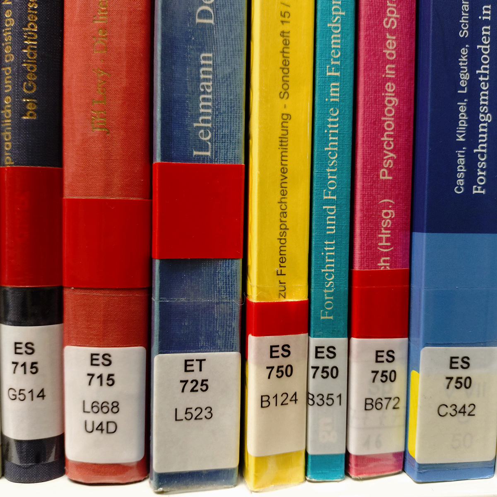 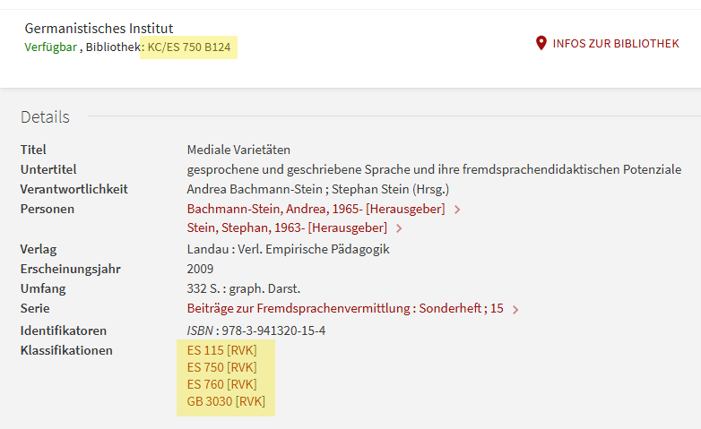

Wieso sehen die Signaturenschilder und der Eintrag "Klassifikationen" im Katalog – hier beispielhaft [in dem der ULB Münster](https://katalogplus.uni-muenster.de/permalink/49HBZ_ULM/o6v3dl/alma991038586399706449 "Link zu einem Medium mi Katalog der ULB Münster") – so aus, wie sie aussehen?

Darum geht es in diesem Kurs.

*************************************************************************************************************

## Wie werden Medien in Bibliotheken erfasst und sortiert?

{{|>}}
*************************************************************************************************************

* **formal**: Medien werden nach formalen Elementen beschrieben (RDA) → bibliografische Angaben im Katalog
* **inhaltlich**: Medien werden nach inhaltlichen Gesichtspunkten beschrieben
  * Verbale Inhaltserschließung → Schlagwörter für die im Medium behandelten Themen (Schlagwörter aus der GND, aus Fachthesauri, frei vergeben usw.)
  * Klassifikatorische oder systematische Inhaltserschließung → Klassifikations- oder Systematik-Stellen/-Klassen für den Kontext des Fachgebietes, in das das Medium gehört (Klassen z.B. aus den Systematiken DDC, BK, UDK – oder eben RVK)

> [!NOTE] 📖
>"Die klassifikatorische Inhaltserschließung [von Medien] beruht auf Klassifikationssystemen mit (meist) hierarchisch geordneten Haupt- und Untergruppen oder Klassen. Diese Gruppen richten sich an einem System der Wissenschaften aus und werden durch Notationen bezeichnet. Bei der Inhaltserschließung durch Klassifizieren wird jede Publikation einer Klasse oder Systemstelle zugeordnet. Alle Publikationen über dasselbe Thema erhalten dieselbe Notation und sind über diese zu ermitteln. Eine Suche mit Hilfe der Klassifikation eignet sich deshalb vor allem dazu, eine Übersicht über die Publikationen zu zusammenhängenden Wissensgebieten zu gewinnen. Um die erschlossenen Titel im Kontext der aktuellen wissenschaftlichen Zusammenhänge nachweisen zu können, müssen bibliothekarische Klassifikationen stets aktuell gehalten werden, neue Klassen für neue Wissenschaftsdisziplinen müssen eingerichtet, Bereiche, in denen besonders viel Literatur anfällt, müssen weiter ausdifferenziert werden.
>
>In modernen Bibliothekskatalogen kann zum einen direkt nach den entsprechenden Notationen gesucht werden, zum anderen lassen sich die Notationen, die bei jedem einzelnen Titel angezeigt werden, auch anklicken. So lassen sich alle Titel zu der entsprechenden Systemstelle bzw. zu dem entsprechenden Thema anzeigen. In älteren Bibliothekskatalogen wurden die gesamten Titeldaten in einem zweiten, systematischen Katalog (SyK) nach der Abfolge der Notationen präsentiert.
>
>In vielen Bibliotheken ist der Bestand auch systematisch aufgestellt, das heißt, verschiedene Werke zum selben Themenbereich stehen unmittelbar nebeneinander. Die Aufstellung ist dann bereits ein Mittel der Inhaltserschließung. Ein Standortkatalog, der ja die Aufstellung des Bestandes abbildet, ist in diesem Fall gleichzeitig ein systematischer Katalog (Systematischer Standortkatalog)." 
>
> *Gantert 2026:232*

*************************************************************************************************************

## Was ist eine Klassifikation?

{{|>}}
*************************************************************************************************************

- in einer Klassifikation werden **Dinge** planmäßig, also systematisch **geordnet** nach bestimmten Kriterien, z.B. nach inhaltlichen Beziehungen
- es werden **Gruppen oder Klassen** gebildet, die durch bestimmte **Zeichen oder Codes aus Zahlen und Buchstaben** dargestellt werden
- Klassifikationen sind also eine Methode zur **Wissensordnung und Wissenspräsentation**
- Beispiele
    - Geowissenschaften: [Systematik der Minerale](https://de.wikipedia.org/wiki/Systematik_der_Minerale "zur Systematik der Minerale")
    - Lebensmittel: [Einteilung von Feiner Backware](https://de.wikipedia.org/wiki/Feine_Backware "zum Wikipedia-Artikel zu Feinen Backwaren")
    - Medizin: [Internationale statistische Klassifikation der Krankheiten und verwandter Gesundheitsprobleme](https://de.wikipedia.org/wiki/Internationale_statistische_Klassifikation_der_Krankheiten_und_verwandter_Gesundheitsprobleme "zum Wikipedia-Eintrag zur ICD") = International Statistical Classification of Diseases and Related Health Problems (ICD)
    - Technik: [Schiffsklassifikationen](https://de.wikipedia.org/wiki/Schiffsklasse#Schiffsklassifikation "zum Wikipedia-Eintrag zur Schiffsklassifikation")
    - Bibliothekswesen: [ASB](https://de.wikipedia.org/wiki/Allgemeine_Systematik_f%C3%BCr_%C3%96ffentliche_Bibliotheken "zum Wikipedia-Eintrag zur ASB"), [DDC](https://de.wikipedia.org/wiki/Dewey-Dezimalklassifikation "zum Wikipedia-Eintrag zur DDC"), [LCC](https://de.wikipedia.org/wiki/Library_of_Congress_Classification "zum Wikipedia-Eintrag zur LCC"), [BK](https://de.wikipedia.org/wiki/Basisklassifikation "zum Wikipedia-Eintrag zur BK"), [TUM-Systematik](https://www.ub.tum.de/tum-systematik-faecher "zur Systematik der Bibliothek der TU München"), zahllose Haussystematiken von Bibliotheken – und die [RVK](https://de.wikipedia.org/wiki/Regensburger_Verbundklassifikation "zum Wikipedia-Eintrag der RVK")

*************************************************************************************************************

## Was ist die RVK für eine Klassifikation?

{{|>}}
*************************************************************************************************************

- die RVK ist eine **Universalklassifikation** für alle Wissenschaftsbereiche
- sie ist **im deutschsprachigen Raum** die **meistgenutzte Systematik in wissenschaftlichen Bibliotheken** 
- ursprünglich wurde sie **in den 1960er-Jahren für die internen Zwecke der Universitätsbibliothek Regensburg entwickelt**; mit der Zeit haben immer Bibliotheken beschlossen, sie ebenfalls für ihre Bestände zu nutzen
- mittlerweile gibt es über 140 "offizielle" Anwendereinrichtungen in Deutschland, Österreich, Italien, Liechtenstein und der Schweiz, die als "RVK-Community" registriert sind, und darüber hinaus zahlreiche weitere, die die RVK "einfach so" einsetzen
- die RVK ist eine Systematik, die in mittlerweile 34 **Fachsystematiken** gegliedert ist:
    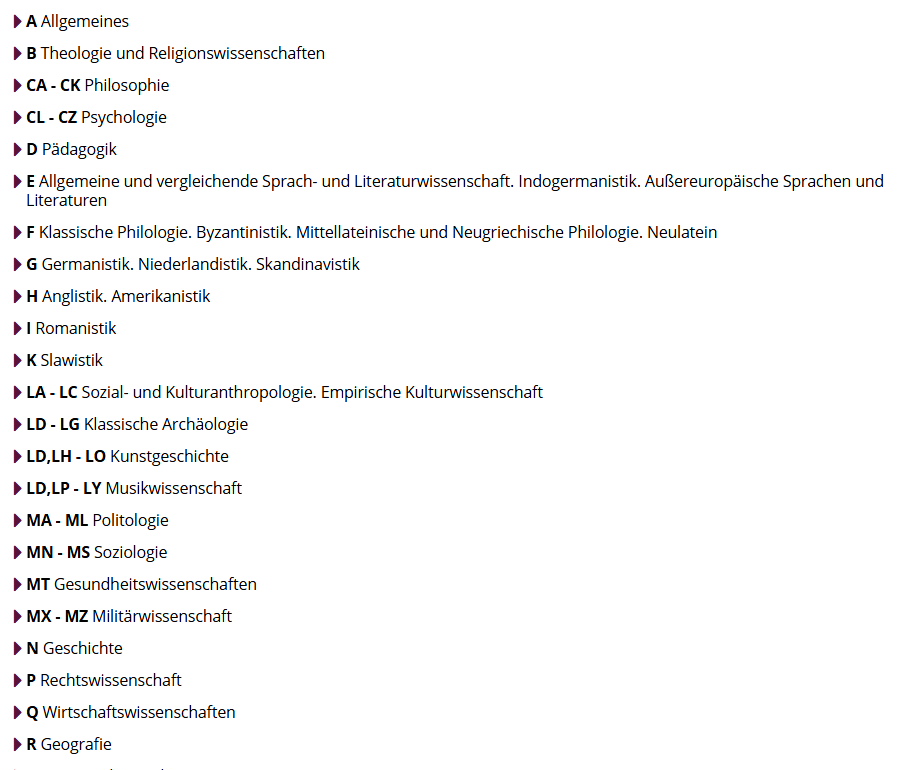
- die **Klassen in den Fachsystematiken** werden mit einer sogenannten **Notation** bezeichnet, die in aller Regel jeweils aus 2 Buchstaben, einem Spatium (Leerzeichen) und drei bis sechs Ziffern besteht
  - Beispiele: SG 500 steht für die "Geschichte der Mathematik", LH 60210 für das Mittelalter in der bildenden Kunst, GB 1668 für Linguistische Bibliografien zu einzelnen Sachbegriffen (Sachgebieten) in der Germanistik, SN 530 für Schachprobleme, NW 6170 für Schokolade, Zuckerwaren in der Wirtschaftsgeschichte, AN 75100 für den Systematischen Katalog in der Sacherschließung in Bibliotheken oder ER 751 für die Geschichte der Schrift
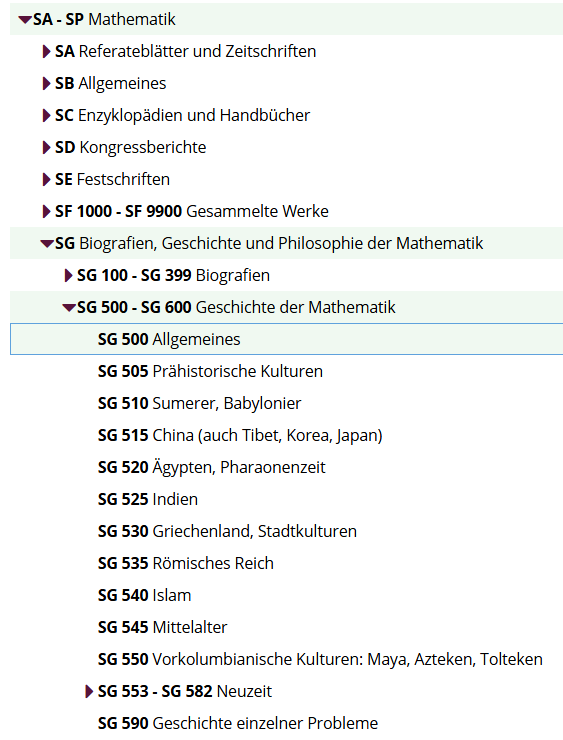 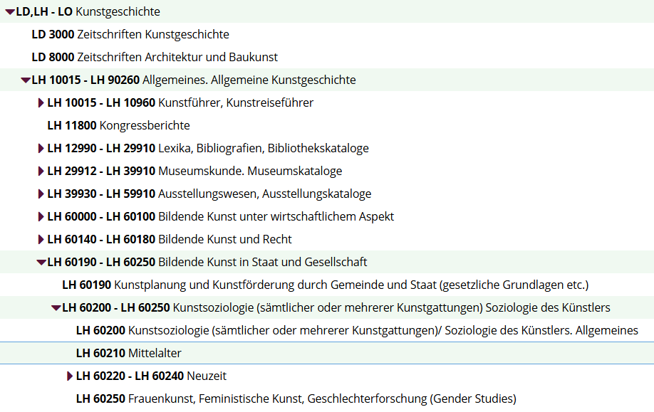 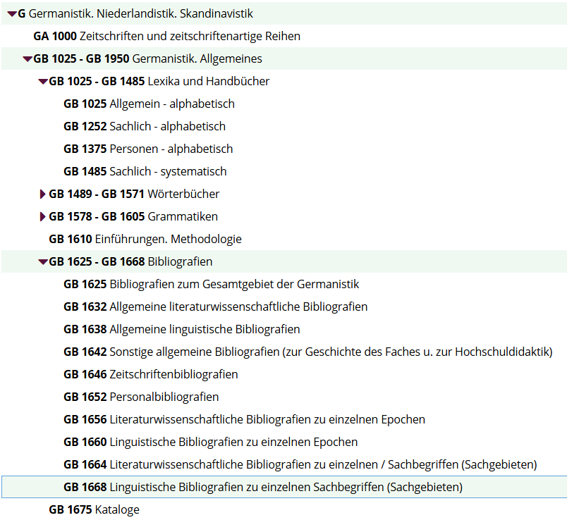 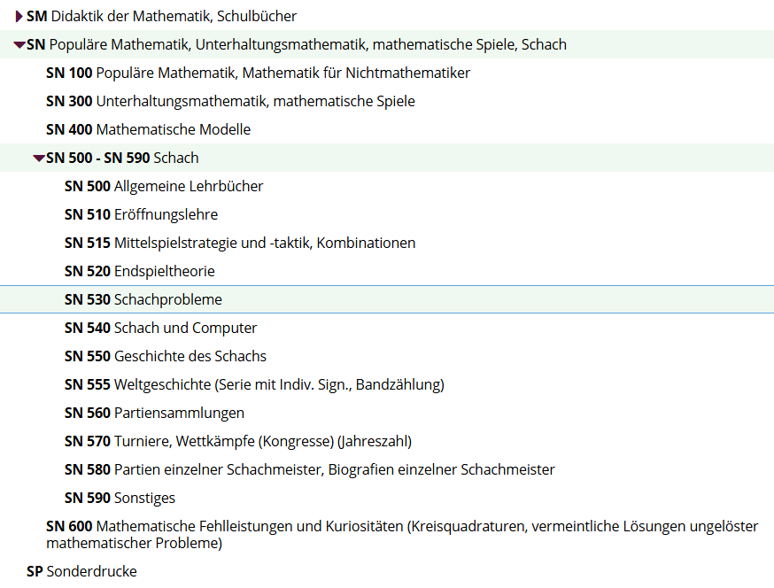  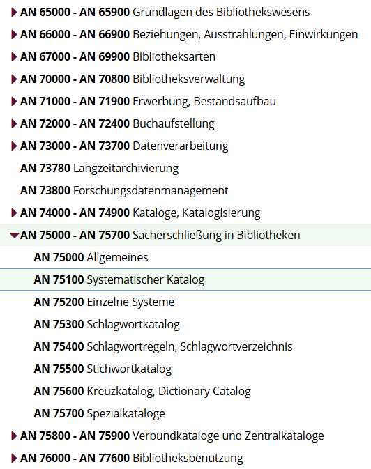 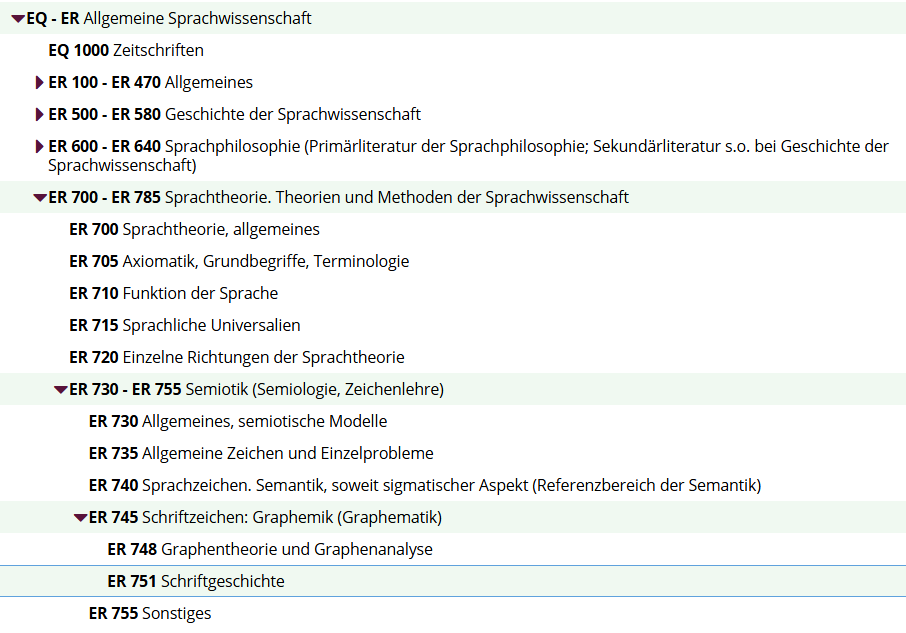
  *Beispiele für Notationen "querbeet durch die RVK"*  
- die RVK ist eine sogenannte **Verbundklassifikation**
  - es gibt eine zentrale Redaktion in Regensburg
  - alle Bibliotheken dürfen die RVK kostenfrei nutzen
  - jede Bibliothek kann selbst entscheiden, welche Notationen sie wählt: es muss nicht jedes Medium gleich behandelt werden
  - zur Verknüpfung von Titeln in Verbundkatalogen dürfen allerdings nur gültige Notationen genutzt werden

*************************************************************************************************************

## Welche Verwendungsmöglichkeiten für die RVK gibt es?

{{|>}}
*************************************************************************************************************

Aufstellung von Medien
=========================
**im Regal vor Ort**  
→ die Notationen werden in Signaturen verwendet  
→ damit ist dann thematisches Auffinden verwandter Literatur oder "Browsen am Regal" vor Ort möglich

*nach RVK aufgestellte Bücher in den Uni-Bibliotheken Greifswald, Mannheim und Münster:*

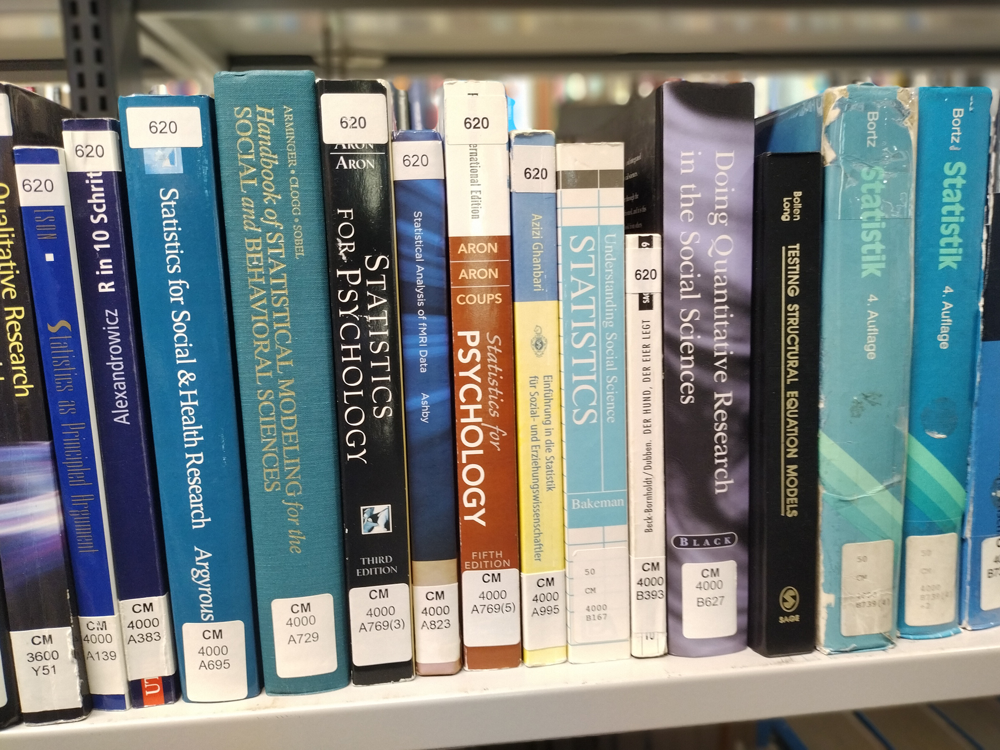 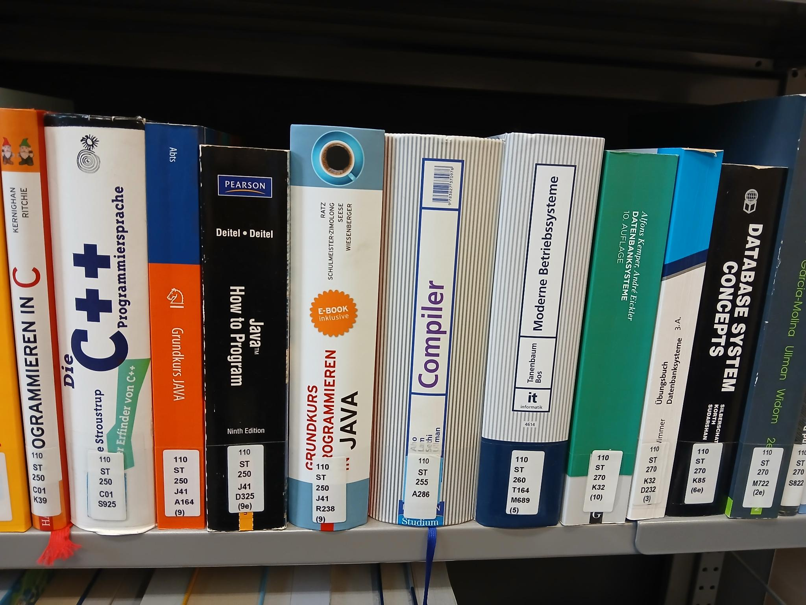 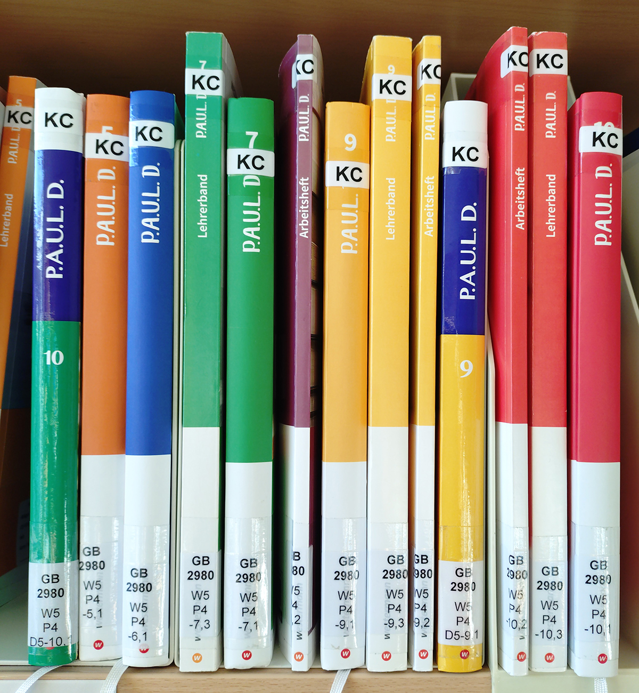

Inhaltserschließung von Medien
=========================
**in Katalogen lokal, regional und überregional**  
→ die Titelaufnahmen in den Katalogen werden mit einer oder mehreren Notationen verknüpft  
→ dadurch sind thematische Recherchen in regionalen und überregionalen Katalogen, Discovery-Systemen usw. möglich

*Beispiel-Katalogeinträge der Uni-Bibliotheken [Greifswald](https://discovery.ub.uni-greifswald.de/search?q=id%3A566068036&v=566068036 "zu einem Medium im Katalog der UB Greifswald"), [Mannheim](https://primo.bib.uni-mannheim.de/permalink/f/19ojnqi/MAN_ALMA21181813300002561 "zu einem Medium im Katalog der UB Mannheim") und [Münster](https://katalogplus.uni-muenster.de/permalink/49HBZ_ULM/dhla6/alma991044929853806449 "zu einem Medium im Katalog der ULB Münster):*

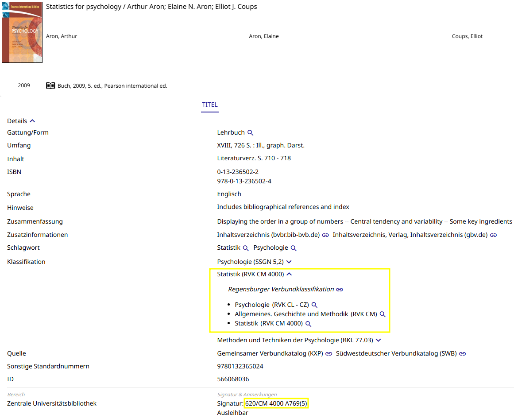 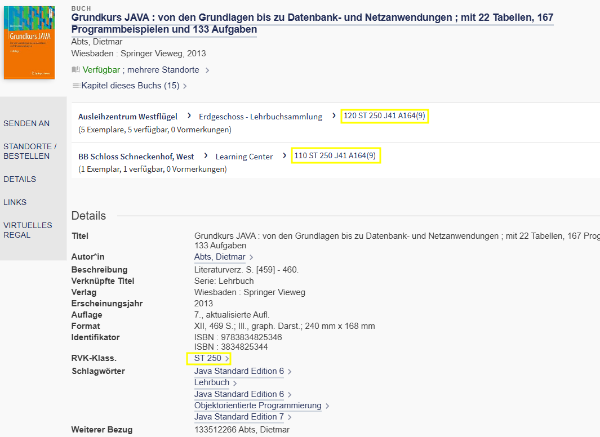 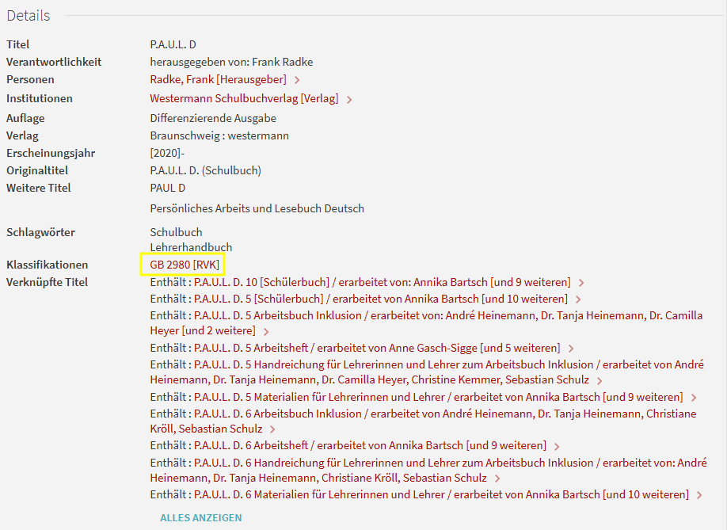

> [!NOTE] 📖
> "In den 1960er Jahren wurde die Regensburger Verbundklassifikation (RVK) als Aufstellungssystematik zur systematischen Erschließung von Beständen in wissenschaftlichen Bibliotheken und Institutionen entwickelt. Inzwischen hat sich in Deutschland, Österreich, der Schweiz, Italien und Liechtenstein ein großer Klassifikationsverbund gebildet. Zahlreiche Universitäts-, Hochschul-und Spezialbibliotheken und weitere Institutionen stellen ihre Bestände ganz oder in Teilen nach RVK auf und nutzen sie als Instrument zur kooperativen Sacherschließung."
> 
> *Gantert 2026:237–240*

> [!NOTE] 📖
> "Ein Anwendungsbereich der RVK ist die systematische Aufstellung von Freihand- und Magazinbeständen. Die systematische Aufstellung im Freihandbereich eröffnet den Nutzern die Möglichkeit, vor Ort am Regal zu „browsen“. Es erschließt sich der gesamte im Freihandbereich stehende Bestand zu einem bestimmten Thema und zu den inhaltlich angrenzenden Themen. Die Notationen der RVK werden ebenso zur inhaltlichen Erschließung der Bestände in Online-Katalogen herangezogen. So eignen sich die systematischen Notationen als Facette zur Einschränkung einer Suchanfrage für die thematische Recherche. Dies ist beispielsweise im Regensburger Katalog, im Gateway Bayern oder im SWB-Online-Katalog in Form eines Sucheinstieges nach Notation realisiert."
> 
> *Häusler/Werr 2018:153*

*************************************************************************************************************

## Wie wird die RVK organisiert?

{{|>}}
*************************************************************************************************************

- die Nutzer:innen der RVK können in zwei Gruppen aufgeteilt werden:
  - die **Anwendergemeinde**
    - die Bibliotheken / Einrichtungen / Privatpersonen, die die im Internet kostenfrei zur Verfügung stehende RVK zur Aufstellung und/oder Sacherschließung nutzen
  - die **RVK-Community**
    - diese Bibliotheken und Einrichtungen – zurzeit rund 140 – haben einen Vertrag mit der UB Regensburg (bzw. mit dem Freistaat Bayern) geschlossen, und sie zahlen einen Jahresbeitrag
    - die Mitglieder der RVK-Community dürfen bei der inhaltlichen Weiterentwicklung der RVK aktiv mitwirken: 
      - sie können Vorschläge für Änderungen und Ergänzungen machen und über eingebrachte Vorschläge abstimmen,
      - sie können sich in den Gremien (z.B. Fachgruppen und RVK-Beirat) einbringen und mitarbeiten,
      - sie bekommen Zugriff auf das Community-Wiki und interne Tools im RVK-Portal

> [!NOTE] 📖 
> "Vor dem Hintergrund der immer größer werdenden Zahl an Anwendern und des damit verbundenen gestiegenen Betreuungsaufwandes wurde im Jahr 2010 nach jahrzehntelanger Eigenleistung der Universitätsbibliothek Regensburg eine geringe Umlagefinanzierung eingeführt. Diese dient der Gewährleistung des technischen Betriebs. Inzwischen sind über \[140\] Bibliotheken und Institutionen dem engeren Anwenderkreis – der RVK-Community – beigetreten (Stand \[Juli 2026\]). Die Mitglieder der RVK-Community beteiligen sich an der inhaltlichen Weiterentwicklung der RVK. Auf diese Weise wird gewährleistet, dass sich die Fachsystematiken am aktuellen Stand der Forschung orientieren."
>
> *Häusler/Werr 2018:156*

- an der **UB Regensburg** gibt es die **Fachkoordination bzw. Koordinierungsstelle für die RVK**
    - eine Fachkoordinatorin und eine Sachbearbeiterin, unterstützende Betreuung durch das IT-Team der UB Regensburg
    - Inhaltliche Betreuung von Änderungs- und Erweiterungsvorschlägen
    - technische Betreuung und Weiterentwicklung: z.B. Updates des Portals, Betrieb des Portal-Servers, Programmierungen (z.B. API, Kollektives Register)
    - organisatorische Betreuung: z.B. Organisation der jährlichen RVK-Konferenz zum Austausch unter RVK-Anwender:innen
- es gibt einen **Beirat** für die RVK
  - wurde 2016 eingerichtet
  - Bibliothekar:innen aus verschiedenen Bibliotheken der RVK-Community + Kolleg:innen aus der UB Regensburg + Vertreter:innen der Bibliotheksverbünde (außer hbz)
  - übergeordnetes Gremium, das sich mit der strategischen und technischen Weiterentwicklung der RVK und ihrer Datenstruktur beschäftigt

> [!NOTE] 📖 
> "Der Arbeitsbereich dieses Gremiums umfasst strategische Planungen und Fragestellungen, die Struktur und technische Weiterentwicklung der RVK als Ganzes betreffen. Der Beirat wird durch die Mitglieder der RVK-Community aus ihren Reihen gewählt. Der RVK-Beirat soll das Prinzip der Zusammenarbeit unter den Anwendern stärken und die RVK im Sinne aller Anwender noch mehr auf die Entwicklungen der Zukunft ausrichten."
>
> *Häusler/Werr 2018:156f*

- für jede Teilsystematik der RVK gibt es **Fachgruppen**
    - Gremien aus Bibliothekar:innen auf Ebene der einzelnen Fachsystematiken: Bewertung von Änderungs- und Neuvorschläge, Pflege, Weiterentwicklung

*************************************************************************************************************

## Wie kommen Änderungen und Ergänzungen in die RVK

{{|>}}
*************************************************************************************************************

über die RVK-Anwendergemeinde
=============================
- die Einrichtungen und Personen der Anwendergemeinde können z.B. formale Fehler wie Tippfehler an die Fachkoordination an der UB Regensburg melden, indem sie in der RVK Online den Button „Kurzkommentare verschicken“ bei den Notationen nutzen

über die RVK-Community
=============================
- die Einrichtungen der Community können an der inhaltlichen Weiterentwicklung mitwirken

Schritt 1:  Einbringen von Änderungs- oder Ergänzungsvorschlägen, z.B. von Notationen 
--------------------------------------------------------------------------------------
- wenn eine Änderung an einer bestimmten Notation beantragt werden soll: im RVK-Portal bei einzelnen Notationen über den Button „Änderungen beantragen“
- wenn Neumeldungen, Änderungen, Ergänzungen oder Löschungen beantragt werden sollen: Einreichen im RVK-Portal über das Neumeldungsformular

Schritt 2: Sichtung durch die RVK-Fachkoordination an der UB Regensburg und durch die Fachgruppen
--------------------------------------------------------------------------------------
- die Vorschläge laufen bei der RVK-Fachkoordination ein und werden nach formalen Gesichtspunkten gesichtet
- dann werden sie an die jeweilige Fachgruppe zur Diskussion weitergeleitet
- die Fachgruppe stimmt der Zulassung zu oder setzt sich mit dem/der Antragsteller:in Verbindung

Schritt 3: Neumeldungslisten
--------------------------------------------------------------------------------------
- die Vorschläge werden nach der Sichtung der Fachgruppen im Community-Wiki im RVK-Portal auf eine Neumeldungsliste gesetzt
- pro Quartal gibt es eine Neumeldungsliste und eine Meldefrist
- nach Ablauf der Meldefrist wird die Vorschlagsliste geschlossen, und die Bibliotheken der RVK-Community sollen dann über die Vorschläge abstimmen und/oder Diskussionen dazu eröffnen
- nach Ablauf einer Abstimmungsfrist gelten die Vorschläge bei entsprechender Abstimmung als angenommen, und wie werden in die RVK eingearbeitet
- wenn Vorschläge abgelehnt oder Einwände dagegen eingebracht werden, wird versucht, einen Konsens zu finden

Schritt 4: Update der RVK
--------------------------------------------------------------------------------------
- jeweils einmal pro Quartal werden die Änderungen in die RVK eingespielt: zu Mitte März, Mitte Juni, Mitte September und Mitte Dezember
- die Bekanntmachung der neuen Notationen erfolgt entsprechend durch vierteljährliche Rundbriefe per Mail, die auch über die Tätigkeiten der Koordinierungsstelle informieren; diese Rundbriefe werden auch im RVK-Portal bereitgestellt

Schritt 5: Einspielen der Updates in die Verbünde
--------------------------------------------------------------------------------------
- für die sogenannten „abnehmenden Systeme“ wie z.B. die Verbundkataloge werden die Update-lieferungen im RVK-Portal als MARCXML zum Download zur Verfügung gestellt
- gelegentlich können zwischen dem Update von RVK-Online, RVK Druck und RVK Einfach und dem Einspielen in den Verbünden ein paar Tage vergehen

  

*Beispiel für eine Änderung einer Notationsbenennung und für die Ergänzung einer neuen Klasse, wie sie in der Neumeldungsliste 96 Ende 2025 zur Diskussion gestellt (und angenommen) wurden:*

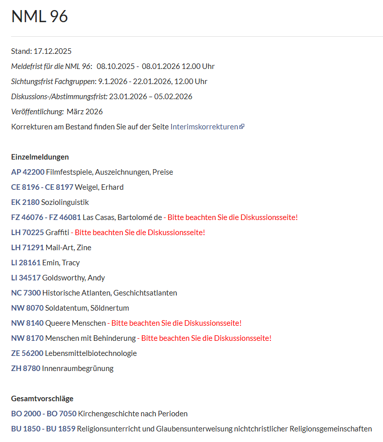 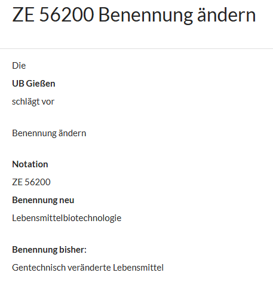 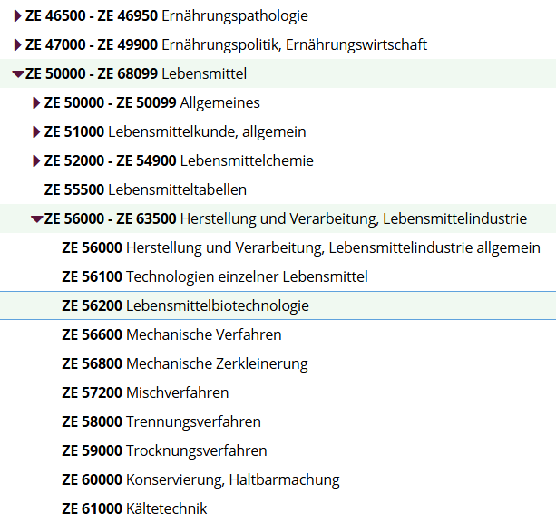 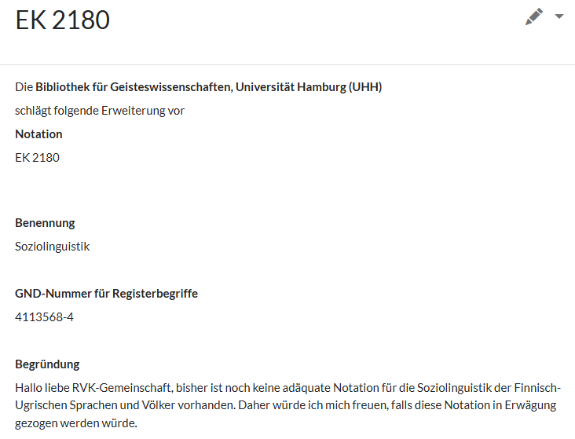 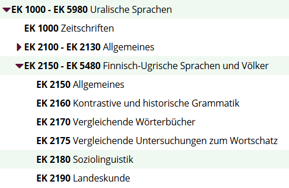

*************************************************************************************************************

## Vorteile & Nachteile der RVK

{{|>}}
*************************************************************************************************************

Vorteile
=========
- verständlicher Aufbau der Fächereinteilung
- breiter Verwendungsbereich: Aufstellungssystematik (Freihand- und Magazinbestände) und Sacherschließung; systematische Aufstellung vor allem für Freihandbestand sinnvoll („Browsen am Regal“)
- große Verbreitung der RVK → Fremddatenübernahme möglich (Arbeitserleichterung, Zeitersparnis, Austausch)
- individuelle Bildung der Signaturen auf Lokalebene möglich
- Webportal und selbsterklärende Funktionen
- technische und organisatorische Betreuung: Ansprechpartner:innen in der RVK-Fachkoordination
- Kooperation mit Verbünden (z.B. bei der Durchführung von Projekten)
- Kooperatives Arbeiten und Weiterentwickeln mit der RVK-Community: RVK-Beirat und RVK-Fachgruppen
- Anpassung an den Wissenschaftsdiskurs (in Grenzen) möglich → relativ gute Aktualität

Nachteile
=========
- Eurozentrismus – zzt. Diskussion "Koloniale Kontexte in der RVK", um zumindest einige Aspekte zu korrigieren
- Begrenzung (noch) auf den deutschsprachigen Raum (englische Übersetzung ist in Arbeit, italienische Übersetzung ist teilweise vorhanden)
- an manchen Stellen begrenzter Notationsvorrat
- bei Änderungen und Ergänzungen Umsignierungsaufwand in den nutzenden Bibliotheken (der aber nicht immer umgesetzt wird)
- im hbz-Verbund noch nicht als Normdatei hinterlegt → Notationen können nur "als Text" eingegeben werden, aber nicht mit ihrer ID

Fazit
======
→ nicht perfekt, aber das Beste, was es zurzeit im deutschsprachigen Raum gibt

Warum die RVK nutzen und nicht z.B. die DDC oder eine Haussystematik?
==========================================================================
- die Nutzung der RVK ist kostenlos, die der DDC ab dem vierten Erschließungslevel kostenpflichtig
- die alphanumerischen RVK-Notationen sind überschaubar und gut zu merken, DDC-Notationen können ggf. sehr lang werden, Haussystematiken beinhalten oft römische Ziffern oder Sonderzeichen
- die RVK ist in Bibliotheken im deutschsprachigen Raum weiter verbreitet als die DDC
- die RVK wird kooperativ gepflegt, Haussystematiken müssen selbst gepflegt werden
- für die RVK stehen viele Fremddaten bereit, die Anwendung von Haussystematiken muss immer "autark" erfolgen

*************************************************************************************************************

## Zum Weiterlesen

{{|>}}
*************************************************************************************************************

- Böttger, Klaus-Peter (2021): **Basiskenntnis Bibliothek: eine Fachkunde für Fachangestellte für Medien- und Informationsdienste – Fachrichtung Bibliothek**. 6., neubearbeitete und erweiterte Auflage Bad Honnef: Bock + Herchen. › Kapitel 11, Inhaltliche Erschließung, Sacherschließung.
- Gantert, Klaus (2026): **Bibliothekarisches Grundwissen**. Berlin/Boston: De Gruyter Saur. [https://doi.org/10.1515/9783111176352](https://doi.org/10.1515/9783111176352 "zum Artikel")>. › Kapitel 3.3 Klassifikatorische Inhaltserschließung.
- Häusler, Ines / Werr, Naoka (2018): „**Die Regensburger Verbundklassifikation (RVK)**“. In: Alex, Heidrun / Bee, Guido / Junger, Ulrike (2018): Klassifikationen in Bibliotheken: Theorie – Anwendung – Nutzen. (= Bibliotheks- und Informationspraxis. 53.) De Gruyter Saur. S. 127–163. [https://doi.org/10.1515/9783110299250-005](https://doi.org/10.1515/9783110299250-005 "zum Artikel").
- Lorenz, Bernd (Hrsg.) (2017): **Handbuch zur Regensburger Verbundklassifikation**. Materialien zur Einführung. 3., überarbeitete Auflage. Wiesbaden: Harrassowitz.
- Lorenz, Bernd (2018): „**Zur Theorie und Terminologie der bibliothekarischen Klassifikation**“. In: Alex, Heidrun / Bee, Guido / Junger, Ulrike (2018): Klassifikationen in Bibliotheken: Theorie – Anwendung – Nutzen. (= Bibliotheks- und Informationspraxis. 53.) De Gruyter Saur. S. 1–22. [https://doi.org/10.1515/9783110299250-001](https://doi.org/10.1515/9783110299250-001 "zum Artikel").
- **RVK-Community › Teilnehmende Bibliotheken**: Liste [auf dieser RVK-Seite](https://rvk.uni-regensburg.de/home?view=article&id=115:teilnehmende-bibliotheken&catid=46 "zur Liste der RVK-Community-Bibliotheken")
- **Übersetzungen der RVK: welche gibt es und wo findet man sie?** › [auf dieser Seite im RVK-Wiki](https://rvk.uni-regensburg.de/?view=article&id=148:uebersetzungen&catid=2 "zur Übersicht über die bereits vorhandenen Übersetzungen der RVK auf den Seiten der UB Regensburg") (eine vollständige Übersetzung der RVK ins Englische ist zurzeit in Vorbereitung) 

*************************************************************************************************************

## Testfragen

{{|>}}
*************************************************************************************************************

"RVK" steht für ...
----------------------------------------------------
- [( )] Regensburger Verbundkatalogisierung
- [(X)] Regensburger Verbundklassifikation
- [( )] Regensburger Versorgungskasse	

	
Die RVK wurde entwickelt ...
----------------------------------------------------
- [( )] in den 1920er Jahren 
- [(X)] in den 1960er Jahren
- [( )] in den 1980er Jahren
- [( )] in den 2000er Jahren
- [( )] in den 2010er Jahren

Die Nutzung der RVK ist ...
----------------------------------------------------
- [(X)] kostenlos
- [( )] kostenpflichtig

Änderungsvorschläge für die RVK werden eingearbeitet ...
----------------------------------------------------
- [( )] jeweils in der Folgewoche
- [( )] einmal im Monat
- [(X)] einmal im Quartal
- [( )] einmal im Jahr

Aus wie vielen Teilsystematiken besteht die RVK?
----------------------------------------------------
- [( )] 10
- [(X)] 34
- [( )] 58
- [( )] 124 

Richtig oder falsch?
----------------------------------------------------
Die RVK deckt als Universalklassifikation alle Wissenschaftsbereiche ab.  
[[ (richtig) | falsch ]]

Der Beirat der RVK entscheidet darüber, wer die RVK nutzen darf.  
[[ richtig | (falsch) ]]

Bibliotheken, die über Änderungsvorschläge mit abstimmen wollen, müssen der RVK-Community offiziell beitreten.  
[[ (richtig) | falsch ]]

Ist Ihre Bibliothek eine "offizielle" RVK-Community-Bibliothek?
----------------------------------------------------
- [Finden Sie es heraus!](https://rvk.uni-regensburg.de/home?view=article&id=115:teilnehmende-bibliotheken&catid=46 "zur Liste der RVK-Community-Bibliotheken")

*************************************************************************************************************

# Das Portal "RVK online"

{{|>}}
*************************************************************************************************************

Zum Einstieg
=============

> [!NOTE] 📖
> "Im RVK-Portal, in dem alle Informationen zur RVK gebündelt werden, steht die RVK in mehreren Versionen zur Verfügung. Zentrales Rechercheinstrument ist die RVK Online, in der man nach Notationen und Benennungen und Registerbegriffen recherchieren kann; viele Notationen sind mit GND-normierten Registerbegriffen verknüpft. Mit der Benennungssuche werden automatisch alle Registerbegriffe durchsucht. Auch das Browsen innerhalb des RVK-Baums ist möglich. 
>
> Aus RVK-Online heraus kann zudem direkt eine Notationssuche in den Verbundkatalogen des Bibliotheksverbunds Bayern (BVB), des Gemeinsamen Bibliotheksverbunds (GBV), des Südwestdeutschen Bibliotheksverbunds (SWB), des Österreichischen (obv) und Schweizerischen Bibliotheksverbunds (swisscovery) sowie in lokalen Katalogen von rund 40 wissenschaftlichen Bibliotheken angestoßen werden."
>
> *Gantert 2026:239–240*

*************************************************************************************************************

## Wo finde ich die RVK online?

{{|>}}
*************************************************************************************************************

* RVK-Portal: [rvk.uni-regensburg.de](https://rvk.uni-regensburg.de/ "zur RVK Online") › linkes Menü: "RVK online"
* die **Oberfläche** ist in **zwei Fenster** eingeteilt:  
  * links sehen Sie den RVK-Baum, darüber befindet sich das zentrale Eingabefeld, in dem man nach Notationen und Benennungen suchen kann
  * im Fenster der rechten Seite ("Ergebnisfenster") werden bei Anwendung die Ergebnisse von Benennungs- und Registersuchen sowie das Tool „CutterJo“ und Details zu ausgewählten Notationen dargestellt
    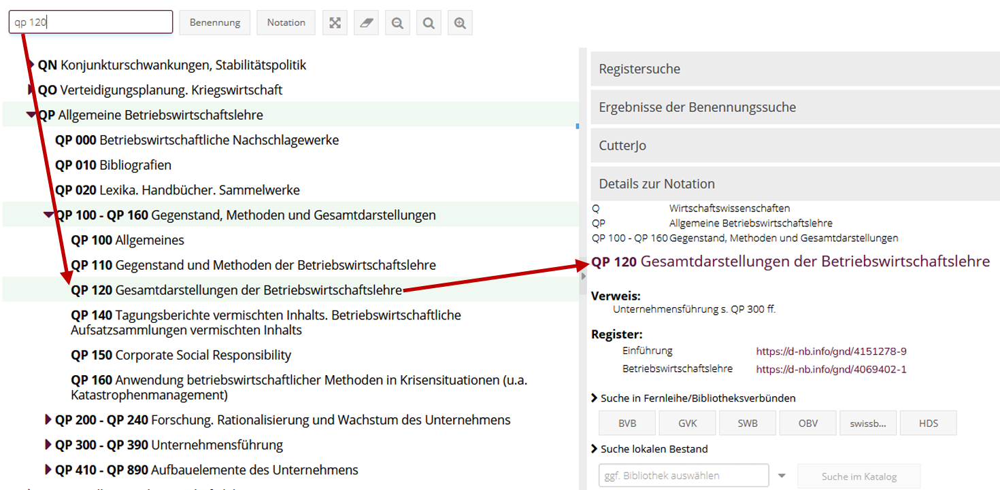
* im Folgenden schauen wir uns die Suchen und die Angaben zu den Notationen genauer an; um den CutterJo wird es im nächsten Kapitel gehen
* die **Breite der beiden Fenster** lässt sich über das Pfeilsymbol im "Mittelbalken" ändern
* mit den beiden Lupen-Buttons +/- können Sie die **Schriftgröße im RVK-Baum** ändern; der mittlere Button ohne +/- setzt sie auf die Voreinstellung zurück
* der Radiergummi-Button dient zum **Zurücksetzen aller Suchanfragen**
* mit demVier-Pfeile-Button wechseln Sie in die **Vollansicht des RVK-Baums** und wieder zurück: die linke Menüleiste wird dabei aus-/eingeblendet
* Stand Herbst 2026 gibt es leider manchmal ein **Problem mit der Anzeige des Baumes**, an deren Behebung gearbeitet wird, die aber aus technischen Gründen noch länger dauern wird:  
  * bei längeren Themenabschnitten friert die Anzeige der Notationen-Hierarchie beim Scrollen per Leiste oder Mausrad manchmal ein, wenn die Länge des "ausgeklappten" Abschnitts die Seitenanzeige überschreitet
  * ein Ein- und wieder Ausklappen behebt das Problem leider nicht; man kann den Bereich dann nur per rechter Maustaste "schieben"

*************************************************************************************************************

## Wozu "RVK Druck" und "RVK einfach", wenn es doch die RVK online gibt?

{{|>}}
*************************************************************************************************************

* aus der zentralen RVK-Datenbank werden drei Versionen generiert und im Portal zur Verfügung gestellt: RVK Online, RVK Druck und RVK Einfach
* RVK Einfach und RVK Druck bieten ergänzende Informationen zur zentralen RVK Online
* Sie finden die Links zu den Varianten im linken Menü des RVK-Portals
* die **RVK Druck** bietet jede Teilsystematik in Form einer PDF-Datei an  
  * die PDF-Dateien enthalten nach der inhaltlichen Struktur jeweils eine Übersicht über sämtliche "Schlüssel", die in dieser Systematik verwendet werden; dazu kommen wir im überübernächsten Abschnitt genauer
  * nach der Auflistung der Notationen der Teilsystematik folgen die Registerbegriffe, die vergeben wurden, verlinkt mit den jeweils passenden Systemstellen; zu den Registerbegriffen siehe den nächsten Abschnitt
  * man kann in den PDF-Dateien gut erkennen, wie tief eine Systematik strukturiert und wie umfangreich sie ist
  * "früher", in der Anfangszeit der RVK, wurden die Fachsystematik in einer Form ähnlich den heutigen PDF-Dateien ausgedruckt und postalisch versandt – das waren noch Zeiten ...
  * 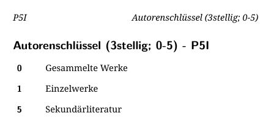 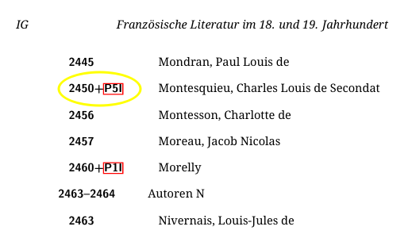 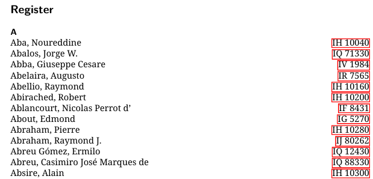
  *ein Schlüssel in der Romanistik-Systematik (I) und der Beginn der Registerbegriff-Liste der Systematik*
* die **RVK Einfach** beinhaltet fachsystematikübergreifende Verlinkungen bei Notationsverweisen und das Gesamtregister aller Registerbegriffe  
  * > [!WARNING] Baustelle
    > Zurzeit (10/2026) ist die RVK Einfach aufgrund von Bot-Angriffen offline. :(  
    > Wenn sie wieder verfügbar ist, tragen wir hier Screenshots zu Notationsverweisen und dem Gesamtregister nach.

*************************************************************************************************************

## Was ist der Unterschied zwischen der Notation, der Benennung und dem Registerbegriff?

{{|>}}
*************************************************************************************************************

* die **Notation** ist der "Code" für eine bestimmte Stelle in einer Systematik; in der RVK besteht eine Notation immer aus zwei Großbuchstaben und drei bis sechs Ziffern  
  * zum Beispiel: WH 8975
  * der Begriff "Notation" wird oft gleichbedeutend verwendet mit "System(atik)stelle" und "(Systematik-)Klasse"
* die **Benennung** ist der Klartext-Name" für die Notation  
  * zum Beispiel "Rodentia (Nagetiere)" für WH 8975 in der Biologie-Systematik W im Bereich H "Evolution"
* da eine Benennung, auch wenn sie durchaus ausführlicher sein kann, nicht immer alle Aspekte eines Themengebietes ausdrücken kann, kann man für Systemstellen **Registerbegriffe** angeben, die verdeutlichen, worum es in dieser Klasse geht  
  * zum Beispiel "Eichhörnchen", "Nagetiere" und "Phylogenie" für WH 8975 Rodentia (Nagetiere)
  * als Registerbegriffe können nur Schlagwörter aus der [Gemeinsamen Normdatei (GND)](https://de.wikipedia.org/wiki/Gemeinsame%5FNormdatei "zum Wikipedia-Artikel zur GND") verwendet werden
  * Mitarbeiter:innen in Bibliotheken, die zur "offiziellen RVK-Community" gehören, können über ein Tool im RVK-Portal Registerbegriffe ergänzen oder korrigieren; Mitarbeiter:innen anderer Bibliotheken können Vorschläge per Mail an die [Fachkoordination an der UB Regensburg](https://rvk.uni-regensburg.de/kontakt "zu den Kontaktdaten der RVK-Fachkoordination an der UB Regensburg") schicken

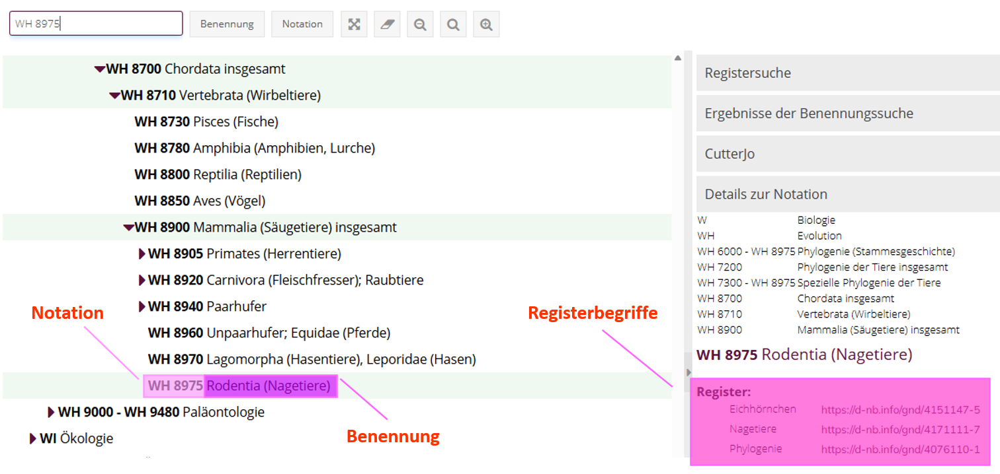

*************************************************************************************************************

## Wie sucht man in der RVK online?

{{|>}}
*************************************************************************************************************

* um gezielt suchen zu können, gibt es im RVK-Portal jeweils eine eigene **Suche** nach Notationen und Benennungen (oben mittig) und nach Registerbegriffen (im rechten Fenster)

Suche nach Notationen und Benennungen
==============================

* drückt man nach Eingabe eines Suchbegriffs im zentralen Suchfeld die Enter-Taste, wird die Benennungs-Suche angestoßen
* für die **Suche nach einer Notation** die Notation eingeben und kurz warten, bis die Anzeige an die entsprechende Stelle im Baum springt (so es die Notation gibt) oder mit der Maus auf den entsprechenden Button klicken  
  * wenn es eine Notation nicht gibt, verändert sich die Anzeige nicht
  * wenn es sie gibt, wird sie mit ihrer Benennung im Baum farbig hinterlegt
  * außerdem öffnet sich im Ergebnisfeld das Fenster „Details zur Notation“: hier findet man die "Herleitung" der Stelle in der Teilsystematik, die Notation und Benennung sowie, falls vorhanden, Registerbegriffe (mit Links raus zur DNB) und Bemerkungen zur Klasse und/oder Verweisungen auf thematisch auch relevante andere Klassen
  * ebenfalls hier zu finden sind Links in die Verbundkataloge von BVB, GBV, SWB, OBV, swisscovery und hebis, die eine Suche nach der jeweiligen Notation in diesen Katalogen anstoßen; außerdem kann man in einigen lokalen Bibliothekskatalogen nach ihr suchen
  * mit dem Button „Kurzkommentare verschicken“ kann jede:r einen Hinweis für die Notation an die Fachkoordination an der UB Regensburg schicken; der Button „Änderungen beantragen“ steht nur Bibliotheken der offiziellen RVK-Community zur Verfügung, die darüber ein Formular für die Meldung von Hinweisen öffnen können
  * wenn eine Notation eine grundlegende Konzeptänderung erfahren hat, wird das ebenfalls angegeben: NC 1930 wurde z.B. aufgrund von Änderungen in dem NC-Zweig 2023 von "Vatikanstaat" in "Ukraine" geändert (der Vatikan gehört seitdem zu NC 1912 Italien, Vatikanstaat)
    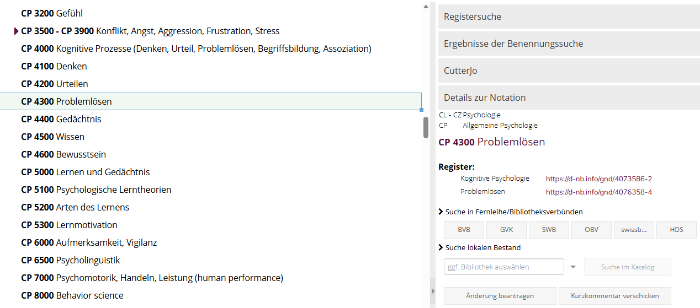
* die Ergebnisse einer **Suche nach einer Benennung** werden im rechten Fenster unter der entsprechenden Überschrift angezeigt  
  * ein Klick auf eine Notation in der Trefferliste führt im Baum links an die entsprechende Stelle
  * dabei wird das Feld „Ergebnisse der Benennungssuche“ im rechten Fenster zugeklappt, damit die Detailinformationen zur Notation angezeigt werden können; die Ergebnisse bleiben aber erhalten, und nach Klick auf den Überschriftenbalken „Ergebnisse der Benennungssuche“ öffnet sich die Trefferliste wieder
  * praktisch für die Sichtung der Treffer: per Mouseover werden für jeden Treffer die Registerbegriffe angezeigt, die für diese Notation eingetragen sind
  * Suchbegriffe bei der Benennungssuche werden übrigens automatisch trunkiert: eine Suche nach "Schokola" findet die Klassen NW 6170 Schokolade, Zuckerwaren und ZE 14400 Schokoladenherstellung
  * bei einer Suche nach Benennungen werden auch die Registerbegriffe nach dem Suchwort durchsucht (in der Variante "Bevorzugte Benennungen", siehe dazu den folgenden Abschnitt)
  * die Ergebnisse einer Benennungssuche können in eine csv-Datei exportiert werden
  * über den Button "Verlauf" kann man die in der aktuellen Browsersitzung durchgeführten Suchen noch einmal aufrufen

Suche nach Registerbegriffen
==============================
* beim Eintippen eines Suchwortes in der Registersuche werden per **Autocomplete** die in der RVK vergebenen passenden Registerbegriffe angezeigt
* nach Anklicken eines Begriffs aus der Vorschlagsliste öffnet sich die **Trefferliste** zu dem Begriff
* man kann **vor der Suche wählen**, ob nur in den sogenannten **Bevorzugten Benennungen**, also den "offiziellen Namen" der Schlagwörter gesucht werden soll oder auch in den **Varianten**, also den synonymen Benennungen und weiteren Namen bzw. Schreibweisen eines Schlagwortes  
  * sucht man z.B. nach "Jet" nur in den bevorzugten Benennungen, findet man nichts
  * die Suche über die Varianten bietet aber die beiden Begriffe "Düsenflugzeug" und "Strahlflugzeug" in der Vorschlagsliste an
  * darüber findet man dann die Notation ZO 7420 Strahlflugzeuge (mit Luftstrahltriebwerk, Strahlturbine, Propellerturbine): der ist nämlich u.a. der Registerbegriff mit der bevorzugten Benennung "Düsenflugzeug" zugewiesen, der die varianten Namen "Jet" und "Strahlflugzeug" umfasst
  * relevant ist dieser Aspekt z.B. bei den unterschiedlichen Schreibweisen von Personennamen: mit "Puschkin" findet man bei den bevorzugten Benennungen nichts, aber über die Varianten findet man das gesuchte Personenschlagwort "Puškin, Aleksandr Sergeevič" und die ihm zugeordneten Notationen
  * der bevorzugte Begriff steht in der Vorschlagsliste immer oben
    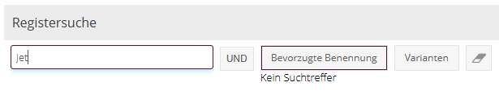 
    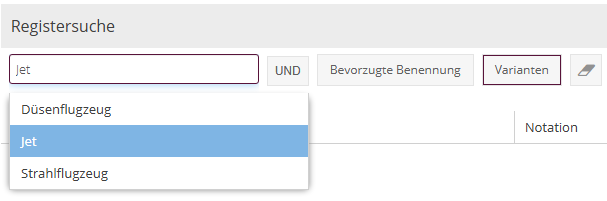
    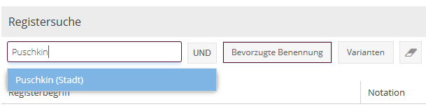 
    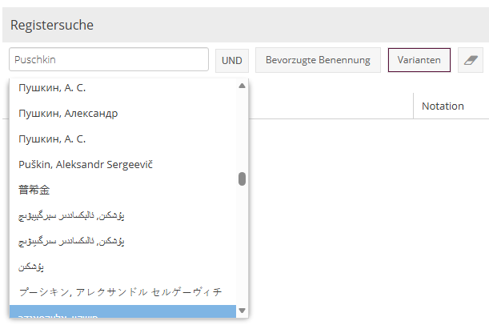
* die Trefferliste kann nach dem Begriff oder der Notation sortiert werden über die Spaltenüberschriften
* bei langen Trefferlisten kann es sich lohnen, sie mit einer **UND-Suche** einzugrenzen:  
  * ein Klick auf den UND-Button generiert eine Liste der Registerbegriffe, die zusammen mit dem aus der ersten Suche auftreten, aus der man dann einen zweiten (oder dritten oder vierten) Begriff wählen kann
  * man kann Begriffe auch wieder aus der kombinierten Suche herausnehmen über den Mülleimer-Button
  * Beispiel: die Suche nach "Landeskunde" und dann über die UND-Verknüpfung die Ergänzung um "Frankreich"
    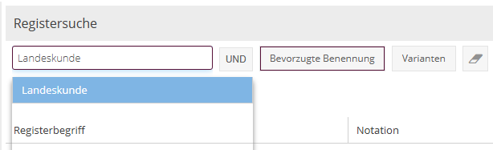 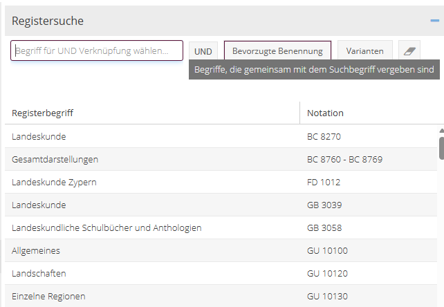 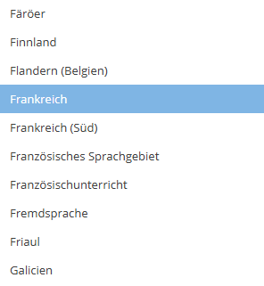 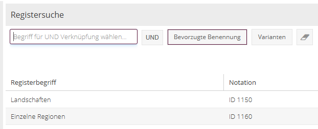

*************************************************************************************************************

## Was hat es mit den Schlüsseln auf sich?

{{|>}}
*************************************************************************************************************

> [!NOTE] 📖
> "Die RVK zeichnet sich durch eine vielfältige und umfangreiche Schlüsselung aus. Diese Schlüssel dienen einerseits der einheitlichen Gliederung wiederkehrender Sachverhalte, andererseits der Arbeitsvereinfachung, denn bei Korrekturen an einem Schlüssel werden alle Notationen, an denen dieser eingerechnet ist, automatisch mitkorrigiert. Jede Fachsystematik hat ihr spezifisches Repertoire an Schlüsseln. Sie sind wie die Fachsystematiken selbst historisch gewachsen und daher nicht gleichmäßig. Dies ist besonders bei schlüsselintensiven Fächern wie etwa der A-Systematik augenfällig.
>
> Insgesamt gibt es \[über 140\] verschiedene Schlüssel (Stand \[Mai 2026\]), die sich von zwei bis zu mehreren hundert Stellen ausdehnen können. Der Sachschlüssel zur Geographie S1R etwa hat 918 Positionen. Die einzelnen Schlüsselpositionen reichen von einer Ziffer (z.B. G1D Regionalschlüssel zur Pädagogik) bis zu drei Ziffern (z.B. Sachschlüssel zur Geographie S1R). Bei den Schlüsseln handelt es sich um numerische Schlüssel, die rein additiv gebraucht werden, d.h. die Ziffern ihrer Stellen werden zu den Ziffern der betreffenden Notation, der Grundnotation oder Grundposition, dazugerechnet. In der RVK-Online sind diese Schlüssel ausgerechnet, d.h. die Ziffern wurden zu den Ziffern der betreffenden Grundnotationen addiert. \[…\]
>
> Die Bandbreite an Schlüsseln reicht von sachlichen und geographischen Schlüsseln, Epochen-, Autoren- und Formalschlüsseln bis zu Schlüsseln, die den Dokumenttyp beschreiben.   
>
> Indem man an die Grundnotation HL 2080 für Bronte, Emily die sechs Ziffern des Schlüssels P5H hinzuaddiert, kommen beispielsweise sechs Notationen für die Autorin Emily Brontë zustande: HL 2080 Gesamtausgaben, HL 2081 Teilsammlungen, HL 2082 Briefe, HL 2083 Einzelausgaben, HL 2084 Übersetzungen von Einzelwerken, HL 2085 Sekundärliteratur."
>
> *Häusler/Werr 2018:133f*

* Schlüssel sind **festgelegte "Sets" von Systemstellen**, die zu Notationsnummern hinzuaddiert werden, um einen bestimmten inhaltlichen Aspekt immer gleich strukturiert abzubilden
* es gibt ganz **verschiedene Schlüssel**: geographisch, zeitlich, für Autor:innen, für formale Aspekte wie den Medientyp, zur alphabetischen Sortierung u.a.m.
* die **Vorteile** der Nutzung von Schlüsseln:
  * die strukturierte Benennung wiederkehrender Sachverhalte
  * die Arbeitsvereinfachung z.B. bei Korrekturen
* die **Nachteile**:
  * die Festlegung u.U. vieler Stellen, die dann ggf. für andere Themen nicht mehr zur Verfügung stehen
  * es können Notationen entstehen, die ohne „Sinn“ sind, wie z.B. "Buchhandel und Verlagswesen in der Arktis" (AN 47999)
* **wo findet man die Schlüsselübersichten?** – wie oben schon erwähnt: in der RVK Druck  
  * die PDF-Dateien der einzelnen Teilsystematiken enthalten neben der Liste der Notationen jeweils eine Übersicht über sämtliche "Schlüssel", die in dieser Systematik verwendet werden
  * bei den Notationen wird durch ein Pluszeichen und den Schlüsselnamen angegeben, dass der jeweilige Schlüssel Anwendung findet, z.B. WB 1110+Z2S
  * aus Platzgründen ist der Schlüssel hier nicht "durchdekliniert", aber die Schlüsselangabe ist mit der Schlüsselliste in der Datei verlinkt
* **in der RVK Online** sind die Schlüssel bereits vollständig eingetragen, und damit werden sie zu einem festen Bestandteil der Notationsbereiche, auf die sie angewendet werden: daher sind sie oft gar nicht als Schlüssel erkennbar  
  * → in der praktischen Arbeit mit der RVK Online muss man also nicht weiter über Schlüssel nachdenken, aber man sollte wissen, dass es sie gibt und wie sie funktionieren

Beispiele für Schlüssel
-----------------------

| Schüsselart | Beispielschlüssel | Gliederung des Beispielschlüssels | Beispielnotation |
| ------ | ----- | ----- | ----- |
| **Autorenschlüssel** zur Gliederung von Primär- und Sekundärliteratur einer/eines Autorin/Autors bzw. über die/den Autor:in | Anglistik & Amerikanistik › P5H | 0 Gesamtausgaben 1 Teilsammlungen 2 Briefe 3 Einzelausgaben 4 Übersetzungen von Einzelwerken 5 Sekundärliteratur | HL 2080 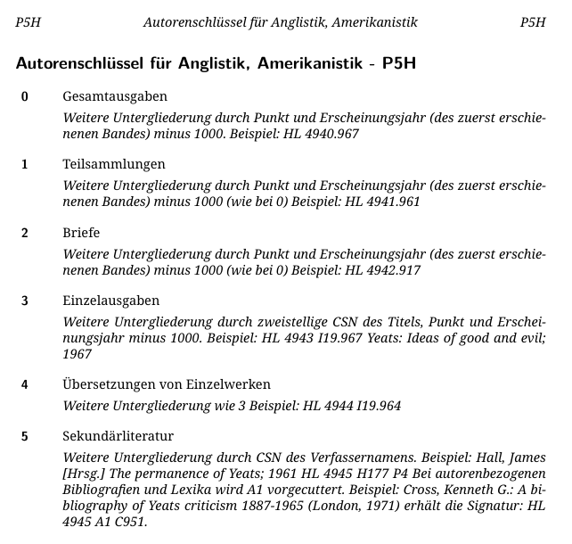 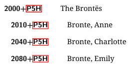 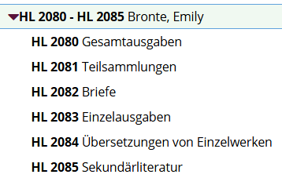 |
| **Epochenschlüssel** wenn ein chronologischer Gesichtspunkt ausgedrückt werden soll | Musikwissenschaft › Z1L | 0 allgemein 1 Antike 2 Frühchristentum, Mittelalter (-1400) 3 Renaissance (1400-1600) 4 Barock, Klassik (1600-1800) 5 19\. Jahrhundert 6 19\. und 20\. Jahrhundert 7 20\. Jahrhundert 8 21\. Jahrhundert | LP 12200   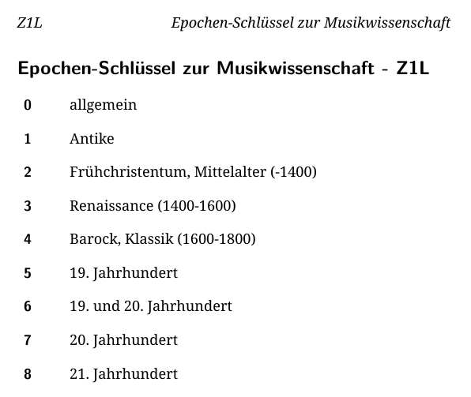 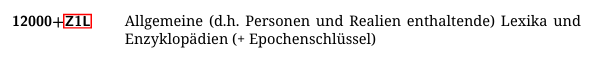 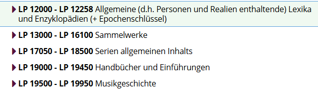 |
| **Formalschlüssel** Form eines Dokuments | Rechtswissenschaften › F1P | 0 Gesetzestexte, Materialien, Entwürfe, Reformliteratur 1 Nachschlagewerke, Formularbücher, Tabellen 2 Tagungs- und Kongressberichte, sonstige Sammelwerke (außer Festschriften) 3 Studienhilfsmittel (z.B. Fall- und Klausursammlungen) 4 Entscheidungssammlungen, Rechtsprechungsübersichten 5 Kommentare 6 Gesamtdarstellungen (z.B. Lehr- und Handbücher, Einführungen) 7 Grundlagen und Methoden 8 Komplexe Untersuchungen; Schriften, die mehrere Untergruppen betreffen; Einzeldarstellungen, soweit nicht im folgenden ausgegliedert | PD 8100 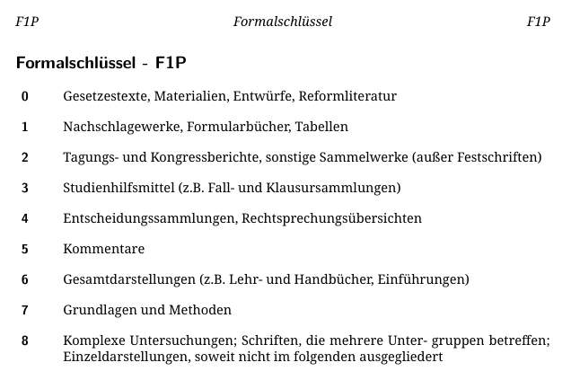 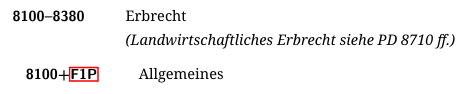 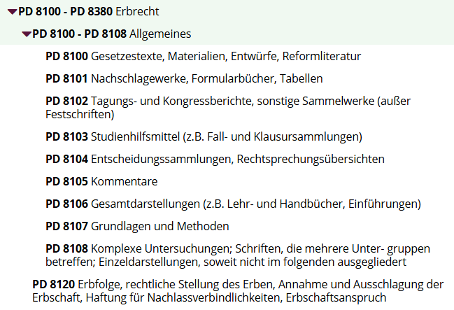   |
| **Geographischer / Regional- / Länder-Schlüssel** zur geographischen sachlichen Ordnung | Pädagogik › G1D| 0 Allgemeines und Deutschland 1 Deutschland (DDR) (1949-1990) 2 USA und Kanada 3 ehem. Sowjetunion, GUS, Russland 4 Großbritannien 5 Frankreich 6 Schweiz 7 Österreich 8 Skandinavien 9 Sonstige | DI 2000 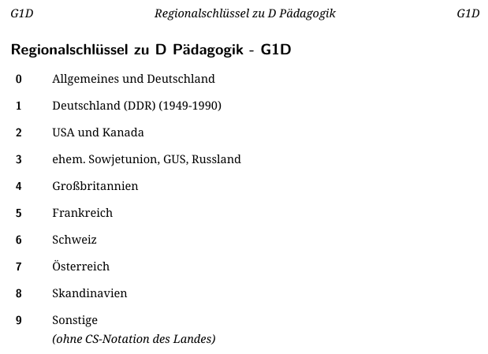 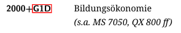 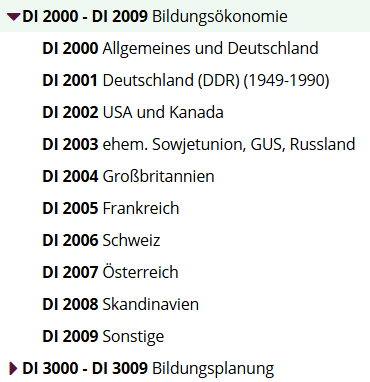 |
| **Zahlenschlüsselung zur alphabetischen Ordnung**kann in allen Systematiken angewendet werden, wenn an der betreffenden Stelle genug Platz zur nächsten Stelle vorhanden ist (mindestens 29 Stellen) | Germanistik, Niederlandistik, Skandinavistik › Z2I | 00 a 01 b 02 c 03 d 04 e usw. | GC 2921 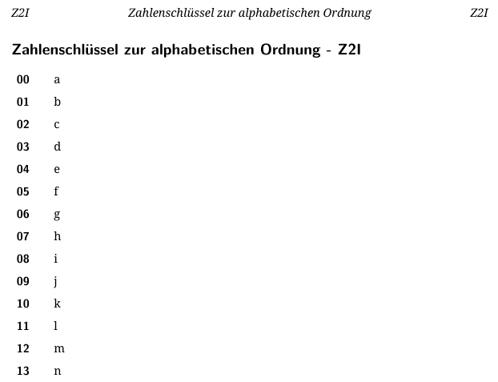 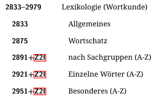 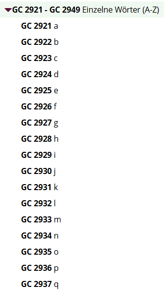 |

*************************************************************************************************************

## Tools

{{|>}}
*************************************************************************************************************

* [**RVK Online**](https://rvk.uni-regensburg.de/regensburger-verbundklassifikation-online "zur RVK Online")
* GND: [**GND-Explorer**](https://explore.gnd.network/ "zum GND-Explorer"), [**lobid-GND**](https://lobid-gnd "zur lobid-GND)

*************************************************************************************************************

## Zum Weiterlesen

{{|>}}
*************************************************************************************************************

* **Anleitung zur Nutzung der RVK** bei den [Nutzungshinweisen zur RVK](https://rvk.uni-regensburg.de/regensburger-verbundklassifikation-online/nutzungshinweise "zu den Nutzungshinweisen zur RVK")  

*************************************************************************************************************

## Testfragen & Übungsaufgaben

{{|>}}
*************************************************************************************************************

Wie lauten die Benennungen der folgenden Notationen?
----------------------------------------------------
* AH  
  [[Wörterbücher]]
* AN 54000 - AN 55800 
  [[Bibliothekspersonal]]
* CC  
  [[ Systemische Philosophie | (Systematische Philosophie) | Logik]]
* ER 450  
  [[ (Nachschlagewerke, linguistische Wörterbücher \(Terminologie\)) | Kongressberichte, Sammelwerke (verschiedener Autoren) | Einzelne Perioden, Richtungen und Personen › 16.–18. Jahrhundert]]
* QT 600< br/>
  [[ Umweltökonomie | Fischerei, Meereswirtschaft | (Wasserreserven) ]]
* VR 2050  
  [[Arzneibücher (Pharmakopöen) anderer Länder | (Internationale Arzneibücher (Pharmakopöen)) | Amtliche Arzneibücher (Pharmakopöen) und ihre Kommentare und Ergänzungsbücher für Deutschland ]]

Wie lauten die Notationen, die diese Benennungen tragen?
----------------------------------------------------
* Bromeliaceae (Ananasgewächse)  
  [[WL 9625]]
* Fahrräder  
  [[ZO 4340]]
* Flugsicherheit  
  [[ZO 7874]]
* Insolvenzrecht  
  [[PU 3284]]
* Onomasiologie (in der E-Systematik)  
  [[ET 415]]
* Schokolade, Zuckerwaren  
  [[NW 6170]]

Richtig oder falsch?
--------------------
* bei BF geht es um Fundamentaltheologie  
  [[ richtig | (falsch) ]]
* die Notationengruppe CN beschäftigt sich mit Differentieller Psychologie  
  [[ richtig | (falsch) ]]
* die Notation ID 2412 steht für den Sprachwandel im Französischen  
  [[ (richtig) | falsch ]]
* die Geschichte der Musikpädagogik findet man unter anderem unter LW 56920  
  [[ (richtig) | falsch ]]
* um Papierforschung geht es in AM 36200  
  [[ richtig | (falsch) ]]
* Im Notationsbereich von ZY 9890 bis ZY 9899 geht es um Computerspiele und E-Sport  
  [[ (richtig) | falsch ]]  

Welche Registerbegriffe sind diesen Notationen zugeordnet?
--------------------
* ZY 7610 - ZY 7619 Voltigieren  
  [[Voltigieren]]
* WE 3300 Ribosomen  
  [[Ribosom]]
* PF 308 Leiharbeit  
  [[Arbeitnehmerüberlassung]]
* ET 425 Einzelprobleme der Bedeutungsentwicklung  
  [[Metapher]]
* EO 2010 Sprachcharakteristik  
  [[Ägyptisch]]
* CP 3800 Aggression, Frustration  
  [[Wut]]

Wie viele Registerbegriffe sind diesen Notationen zugeordnet?
--------------------
*Tragen Sie die Antwort als Ziffern ein.*

* FL 10000 Allgemeine Sammlungen  
  [[2]]
* LW 56967 Hörerziehung, Werkhören, Gehörbildung im Unterricht  
  [[3]]
* RR 73651 Teilgebiete und Einzelfragen  
  [[3]]
* QF 020 Deutschland  
  [[4]]
* WT 3832 Monotremata (Kloakentiere) Didelphia (Beuteltiere)  
  [[0]]
* ZO 7025 Luftfahrtpersonal  
  [[9]]

Wie heißt der Schlüssel F1B in der Theologie?
--------------------
- [( )] "Reihenfolge bei Textausgaben"
- [( )] "Autorenschlüssel"
- [( )] "Autorenschlüssel zur jiddischen Literatur"
- [(X)] "Schlüssel zu Religionen der Menschheit"
- [( )] "Schlüssel zur Territorialkirchengeschichte"
- [( )] "Schlüssel zur Homiletik"
- [( )] "Autorenschlüssel zu BW Evangelische Theologie"

Wie viele Stellen hat der Autorenschlüssel P4H für Anglistik und Amerikanistik?
--------------------
- [( )] 1
- [( )] 2
- [( )] 3
- [( )] 4
- [(X)] 5
- [( )] 6
- [( )] 7

Sie haben einen Tippfehler in einer Notationsbezeichnung oder in der Anmerkung zu einer Notation gefunden. Was tun Sie?
--------------------
- [( )] Ich Ignoriere ihn: Wird sich schon irgendwer drum kümmern.
- [(X)] Ich melde ihn per "Kurzkommentar verschicken" formlos an die Kolleg:innen in der UB Regensburg, damit er verbessert werden kann.

*************************************************************************************************************

# Notationen & Signaturen

    {{|>}}
*************************************************************************************************************

Zum Einstieg
=============

> [!NOTE] 📖
> "Die Notationen in der RVK sind alphanumerisch aus zwei lateinischen Großbuchstaben für die Haupt- bzw. Untergruppe, einem Spatium und drei bis \[sechs\] arabischen Ziffern für die weiteren Untergliederungsebenen gebildet. \[…}  
> Mit der Notation erfolgt die sachliche Zuordnung eines Mediums.  
> Die meisten Anwender der RVK nutzen die Notationen neben der klassifikatorischen Erschließung zur Signaturbildung. Die Signatur wird durch Erweiterung der Notation gebildet. Jedes Medium erhält auf diese Weise eine Individualsignatur, die den Standort des Mediums innerhalb der Gesamtaufstellung eindeutig festlegt.   
> Eine Signatur besteht aus dem Lokalkennzeichen, der Notation und individualisierenden Elementen".
>
> *Häusler/Werr 2018:132*

*************************************************************************************************************

## Was ist der Unterschied zwischen einer RVK-Notation und einer RVK-Signatur?

{{|>}}
*************************************************************************************************************

Notationen
==========

* eine Notation **repräsentiert eine Klasse oder Systemstelle in der Klassifikation**
* in der RVK bilden die mit **Großbuchstaben** abgebildeten **Hauptgruppen** die erste Ordnungsebene der Systematik  
  * Beispiele: D = Pädagogik, MA–ML = Politologie, MN–MS = Soziologie, MX–MZ = Militärwissenschaft
* die **Untergruppen** stellen die zweite Ordnungseinheit der Systematik dar; sie grenzen die Hauptgruppe formal oder inhaltlich ein und werden durch eine **Buchstabenkombination** gekennzeichnet, die aus dem Hauptgruppenbuchstaben und einem weiteren Großbuchstaben besteht
  * die Aufteilung und die inhaltliche Zuordnung der Untergruppenbuchstaben hängen vom jeweiligen Fachgebiet und den verfügbaren Buchstaben ab; nur A wird stets für Zeitschriften verwendet
  * Beispiel:  
    V = Chemie und Pharmazie (Hauptgruppe)  
    VE = Physikalische und theoretische Chemie (Untergruppe)  
    VT = Pharmakologie und Toxikologie (Untergruppe) 
* zur weiteren Gliederung der Untergruppen in **Feingruppen** werden **drei- bis sechsstellige Zahlenreihen** gebildet, je nachdem wie viele Feingruppen innerhalb einer Untergruppe vorkommen sollen
  * Beispiel:  
    X–Y = Medizin (Hauptgruppe)  
    XE = Hygiene (Untergruppe)  
    XE 5700 = Tropenmedizin, Allgemeines (Feingruppe)  
    XE 6100 = Arbeitshygiene (Feingruppe)  

Signaturen
==========

* Signaturen haben die **Funktion**, den **Standort eines Buches oder eines anderen Mediums innerhalb der Gesamtaufstellung eindeutig festzulegen**
* sie müssen deshalb für jede bibliographische Einheit verschieden sein, d. h. jeder Band muss eine **Individualsignatur** tragen, die ihn von allen anderen Bänden unterscheidet
* wenn man die RVK zur Aufstellung von Medien verwenden will, bedeutet das: zur inhaltlichen Notation müssen noch Elemente hinzukommen, die sich auf das jeweils vorliegende Werk beziehen
* neben der eindeutigen Identifikation eines Bandes wird dann auch eine alphabetische oder chronologische Ordnung innerhalb der Systemstelle der Notation erreicht
* die **Grundprinzipien zur Signaturenvergabe**:  
  * jedes Medium erhält nur eine Signatur
  * das wichtigste Prinzip: die Signatur soll eindeutig sein
  * das zweitwichtigste: die Signatur soll so kurz wie möglich sein
  * verwendet werden
    * lateinische Großbuchstaben
    * arabische Ziffern
    * einige festgelegte Interpunktionszeichen
* eine RVK-Signatur besteht in der Regel aus **drei Teilen**:
  * einem **Lokalkennzeichen** (kurz LKZ), das den Standort der Aufstellung des Mediums angibt, z.B. eine (Teil-)Bibliothek › wird von den Bibliotheken ortsspezifisch festgelegt
    * es bezeichnet den Ort der Aufstellung bzw. die Zugänglichkeit eines Buches
    * das Lokalkennzeichen kann ggf. auch Hinweise zum Medientyp oder zur Ausleihbarkeit geben
    * Lokalkennzeichen bestehen aus 1–3 Ziffern oder Buchstaben
  * der systematischen, also "inhaltlichen" **Notation** › wird der RVK Online entnommen
  * der **Individualisierung** für den spezifischen Band › wird selbst erstellt oder aus Fremddaten übernommen

Beispiele für RVK-Signaturen
-----------------------------

| **Lokalkennzeichen (LKZ)** | **Notation** | **Individualisierung** |
|------- | ------------ | ---------------------- |
| 00      | 500 GC 1015  | E71                    |
| 500     | EC 1879      | W846 S452              |
| 61      | ER 745       | D853(3)                |
| KC      | GE 4001      | B724(9)-2+3            |

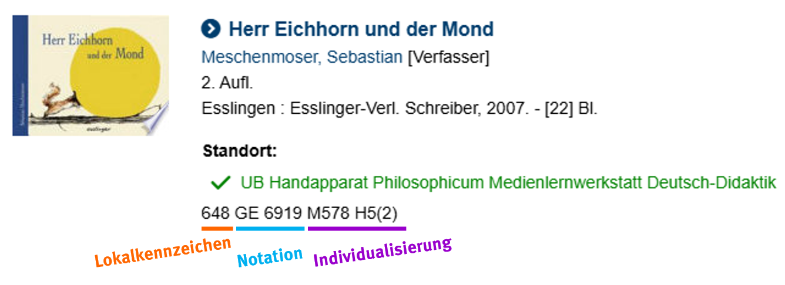

Lokalkennzeichen
----------------

* die **Lokalkennzeichen** bestehen meistens aus Zahlen, manchmal auch aus Buchstaben  
  * man kann auch auf das Lokalkennzeichen verzichten, wenn es z.B. nur einen Bibliotheksstandort gibt oder nur eine Bibliothek von mehreren einer Einrichtung die RVK zur Aufstellung nutzt
    
  *61, 620, KC: Beispiele für Lokalkennzeichen in den Uni-Bibliotheken Regensburg, Greifswald und Münster*

Individualisierender Teil
--------------------------

* der **individualisierende Teil** umfasst mehrere Elemente  
  * Kürzel für Urheber:innen, also z.B. Verfasser:in oder Herausgeber:in
  * ggf. Kürzel für den Titel des Werkes
  * Angaben zu Auflage, Band, Exemplar
* die **Kürzel für Urheber:innen und für Titel** werden nach dem "Cutter-Verfahren" gebildet – dazu mehr im folgenden Abschnitt

 
*Beispiel für ein "einfaches" Buch in unterschiedlichen Darstellungen*

  
*Beispiele für ein "komplexeres" Buch in unterschiedlichen Darstellungen*

> [!NOTE]
> Die einzelnen thematischen Systemstellen bzw. Klassen der RVK, die zur Einordnung von Medien verwendet werden, werden mit **Notationen** gekennzeichnet.   
> → Beispiel: ET 410 Historische Semantik
> 
> Die einzelnen Medien erhalten für ihre Aufstellung im Regal eine **Signatur**, die aus der Notation und einigen anderen Bestandteilen besteht.   
> → Beispiel: KC/ET 410 S839 als Signatur für das Buch„Meaning and change of meaning“ von Gustaf Stern in der Bibliothek des Germanistischen Institutes im Vom-Stein-Haus der Universität Münster

*************************************************************************************************************

## Wie geht das mit diesem "Cuttern"?

{{|>}}
*************************************************************************************************************

* die Grundidee des "Cutterns" ist eine feingliedrige alphabetische Ordnung von Titeln oder Namen
* die Kürzel, die dazu verwendet werden, werden nach ihren "Erfinder:innen", Charles Ammi Cutter und Kate Emery Sanborn, Cutter-Sanborn-Nummern, Cutter-Nummern oder kurz einfach nur "Cutter" oder "CSN" genannt
* das Prinzip: das jeweilige Ordnungswort – ein Name oder ein Werktitel – werden durch eine Buchstaben-Ziffern-Kombination verschlüsselt: sie besteht aus dem ersten Buchstaben des Ordnungswortes und einer ohne Leerstelle angeschlossenen ein- bis dreistelligen Zahl
* die Zahl basiert auf einer Tabelle, die Charles Cutter und Kate Emery Sanborn in den 1960ern entwickelt haben

* heutzutage muss man aber nicht mehr im Tabellenbuch blättern, sondern es gibt ein Online-Tools dafür von der UB Eichstätt-Ingolstadt: der "CutterJo“ ist zu finden unter [hub.ku-eichstaett.de/cgi-bin/cutterjo.pl](https://www.ub.ku-eichstaett.de/cgi-bin/cutterjo.pl "zum CutterJo der UB Eichstätt-Ingolstadt") oder integriert im rechten Bereich der RVK-Online unter [rvk.‌‌uni-regensburg.de](https://‌rvk.‌‌uni-regensburg.de "zur RVK Online")

   
  *das "CutterJo"-Tool auf der Seite der UB Eichstätt-Ingolstadt und integriert im Portal RVK-Online*

* die "Verschlüsselung" des Ordnungswortes, also die Auswahl der CSN, wird "cuttern" oder "vercuttern" genannt
* Beispiele:  
  * Aristoteles = A717, Mustermannn = M991, Schmidt, Andreas = S349, Schmidt, Martin = S353, Waalkes = W111
  * Eichhörnchen = E34, Einführung = E35, Handbuch = H236, Introduction = I61, Linguistics = L755, Süßwarenindustrie = S944
* für die Verschlüsselung eines in der Cutter-Sanborn-Tafel nicht selbst ausgewiesenen Ordnungswortes ist die Nummer des alphabetisch vorausstehenden, nicht des nachfolgenden Ordnungswortes maßgebend: z.B. „Produk“ = P964 wie „Proct“, und nicht P965 wie „Prom“; der CutterJo "rechnet" das aber selbst richtig aus
* es dürfen nur CSNs verwendet werden, die in der Tafel angegeben sind; die Ziffer Null kann daher nicht vorkommen
* weiterführende Informationen zum Beispiel zu Spezialfällen bei Namen gibts im Kapitel "RVK zur Aufstellung von Medien"
* warum macht man sich die Arbeit mit dem Cuttern und nimmt nicht einfach Numerus Currens für die Aufstellung der Medien?  
  * durch die Verwendung von CSNs erhält eine Notation eine alphabetische "Binnengliederung" nach den Urheber:innen der Werke oder, z.B. in Primärliteratur-Klassen, nach den Werktiteln
  * damit stehen dann alle Werke eines/einer Verfasser:in oder Herausggeber:in zu einem Thema nebeneinander, und wenn es mehrere Ausgabe oder Übersetzungen gibt, stehen auch die beisammen
  * bei Bedarf kann man mit "Vorcuttern" auch formale oder thematische Gruppen innerhalb einer Klasse bilden
  * all diese nützlichen Gliederungen stehen nicht zur Verfügung, wenn man Numerus Currens nutzt

*************************************************************************************************************

## Was wird gecuttert?

{{|>}}
*************************************************************************************************************

* im Normalfall genügt es, die/den **Verfasser:in / Herausgeber:in / Urheber:in** zu cuttern:  
  * Beispiel: KC/GB 2944 M946 = Hans-Georg Müller, "DeutschGPT – Deutschunterricht im Dialog mit Künstlicher Intelligenz"
* wenn aber jemand mehrere Bücher zu einem Thema (= in einer RVK-Klasse) geschrieben hat, wird zur Unterscheidung der Bücher ein Cutter für den **Titel der Werkes** ergänzt  
  * der Titel-Cutter kann auf zwei oder eine Zahl gekürzt werden, wenn das zur Unterscheidung mehrerer Werke einer Autorin oder eines Autors genügt; man spricht dann von einem "Kurz-Cutter"
  * sollte die Autorin bzw. der Autor mehrere Bücher mit dem gleichen Titelanfang geschrieben haben, werden sie über unterschiedliche lange Titel-Cutter unterschieden
  * Beispiele:  
    * KC/GB 2946 B527 = *Bernhardt*, Sebastian (Hrsg.): Literatur in Lehrwerken für den Deutschunterricht
    * KC/GB 2946 B527 U6 = *Bernhardt*, Sebastian (Hrsg.): *Unterrichtshilfen* für den Literaturunterricht
    * KC/GB 2976 B527 = *Bernhardt*, Sebastian (Hrsg.): Interpretation - Literaturdidaktische Perspektiven
    * KC/GB 2978 B527 = *Bernhardt*, Sebastian (Hrsg.): Frühkindliches Spiel und literarische Rezeption: Perspektiven der Kindheitspädagogik und der Literaturdidaktik
    * KC/GB 2978 B527 E7 = *Bernhardt*, Sebastian (Hrsg.): *Erzähltheorie(n)* und Literaturunterricht: Verhandlungen eines schwierigen Verhältnisses
    * KC/GB 2978 B527 L7 = *Bernhardt*, Sebastian (Hrsg.): *Literarästhetisches* Lernen im Ausstellungsraum: Literaturausstellungen als außerschulische Lernorte für den Literaturunterricht
    * KC/GB 2978 B527 L77 = *Bernhardt*, Sebastian (Hrsg.):* Literaturausstellungen* und Vermittlung: transdisziplinäre Perspektiven
    * KC/GB 2978 B527 L776 = *Bernhardt*, Sebastian (Hrsg.): *Literarästhetisches* Lernen außerhalb des Klassenzimmers: Interdisziplinäre Perspektiven
    * KC/GB 2978 B527 L776 P9 = *Bernhardt*, Sebastian (Hrsg.): *Literaturunterricht* in der *Primarstufe* zwischen Themenorientierung und Ästhetik
    * KC/GB 2978 B527 L776 S4 = *Bernhardt*, Sebastian (Hrsg.): *Literaturunterricht* in den *Sekundarstufen* zwischen Themenorientierung und Ästhetik
    * KC/GB 2978 B527 U6 = *Bernhardt*, Sebastian (Hrsg.): *Unzuverlässiges* Erzählen in Literatur und Medien: didaktische Perspektiven
* weiterführende Informationen zur Auswahl der zu cutternden Ordnungswörter und Spezialfälle gibts im Kapitel "RVK zur Aufstellung von Medien"

*************************************************************************************************************

## Der Krams hinter den Cutter-Nummern: Band, Auflage, Übersetzung, Exemplar

{{|>}}
*************************************************************************************************************

Da ja jedes Werk seine ganz eigene Signatur bekommen soll, werden formale Aspekte zur Individualisierung der Signatur genutzt.

Bandzählung
-----------

* die Zählung von Bänden (oder auch Abteilungen oder ähnlichen Untergliederungen) wird mit Bindestrich ohne Leerzeichen an den Urheber- oder Titel-Cutter angefügt
* es können bis zu zwei weitere untergeordnete Zählungen z.B. für Teilbände, mit Komma angehängt werden
* Beispiele  
  * 12/ER 450 H535-2 = Band 2 eines mehrbändigen Werkes
  * 12/ES 940 E57-1,1 = vom Band 1 eines mehrbändigen Werkes der Teilband 1

Auflagenbezeichnung
-------------------

* die Auflagenbezeichnung wird – außer bei der ersten Auflage – ohne Leerzeichen in runden Klammern angefügt
* Zusätze wie „erweiterte“, „neubearb.“ usw. entfallen
* Beispiele  
  * 61/HF 350 C991(2) = 2\. Aufl.
  * 61/HF 350 C991(3) = 3\. Aufl.
  * 61/FH 15900 V878-2(5) = Bd. 2, 5\. Aufl.
* bei mehrbändigen Werken mit verschiedener Auflage der Einzelbände kann die Auflagenbezeichnung vor oder nach der Bandzählung stehen, je nachdem, ob die Bände oder die vollständigen Auflagen nebeneinanderstehen sollen  
  * 00/GE 4001 F879(25)-5 = 25\. Aufl. eines mehrbändigen Werkes, Band 5 – die vollständigen Auflagen stehen nebeneinander im Regal
  * 00/AH 11000 D845-2(8) = 2\. Band eines mehrbändigen Werkes, 8\. Auflage – die einzelnen Bände stehen in ihren unterschiedlichen Auflagen nebeneinander im Regal

Mehrfachexemplare
-----------------

* Mehrfachexemplare am gleichen Standort werden durch +2, +3 usw. (ohne Leerstelle) bezeichnet
* Mehrfachexemplare an verschiedenen Standorten sind bereits durch die Lokalkennzeichen hinlänglich unterschieden
* Beispiele  
  * 11/GW 2230 H634+2 = 2\. Exemplar
  * 11/GF 5101 L138-2(6)+5 = 5\. Exemplar der 6\. Auflage des 2\. Bandes

Übersetzungen
-------------

* bei Übersetzungen wird der Originaltitel des Werkes als Ordnungswort verwendet, an dessen CSN dann ein Großbuchstabe für die Sprache der Übersetzung angehängt wird
* in den meisten Fällen wird ein Kurz-Cutter für den Titel genügen
* Beispiele  
  * 50/EC 3765 L192 M5 = George Lakoff: "Metaphors we live by", engl. Original
  * 50/EC 3765 L192 M5D = George Lakoff: "Leben in Metaphern", dt. Übersetzung von "Metaphors we live by" (und nicht L442)
  * 50/IH 91900 G279 J4 = Anna Gavalda: „Je voudrais que quelqu’un m’attende quelque part”, frz. Original
  * 50/IH 91900 G279 J4D = Anna Gavalda: „Ich wünsche mir, dass irgendwo jemand auf mich wartet“, dt. Übersetzung von „Je voudrais que quelqu’un m’attende quelque part“ (und nicht I16)
  * 50/GN 9999 S295 S399 = Frank Schätzing, „Der Schwarm“, dt. Original
  * 50/GN 9999 S295 S399E = Frank Schätzing, „The Swarm“, engl. Übersetzung von „Der Schwarm“ (und nicht S973)

Weiterführende Informationen zu diesen Signaturenbestandteilen gibts im Kapitel "RVK zur Aufstellung von Medien".

> [!NOTE] 📖
> "Wird die RVK zur Sacherschließung genutzt, werden die systematischen Notationen auf Verbundebene mit den Titeldatensätzen der Medien verknüpft. Wird die RVK zusätzlich zur systematischen Aufstellung der Medien genutzt, wird auf Lokalebene mit Hilfe der Notation für jedes Medium eine Individualsignatur gebildet.
>
> Die Individualsignatur besteht in der Regel aus drei Teilen: dem Lokal-oder Standortkennzeichen, der RVK-Notation und einem oder mehreren individualisierenden Elementen. Das Lokalkennzeichen (LKZ) bestimmt den Aufstellungsort oder die Zugänglichkeit des Mediums, gelegentlich auch den Medientyp. Es kann aus Ziffern oder anderen Zeichen bestehen. Die RVK-Notation bestimmt die sachliche Einordnung des Mediums. Die RVK-Notationen bestehen immer aus zwei lateinischen Großbuchstaben, einem Spatium und einer Zahlenfolge von 3 bis 5 arabischen Ziffern. Der erste Großbuchstabe bezeichnet i. d. R. die erste Ordnungsebene oder die Hauptgruppe der 34 Fachsystematiken der RVK \[…\]. Der zweite Großbuchstabe kennzeichnet die zweite Ordnungsebene oder die Untergruppe. Zur weiteren Untergliederung werden drei-bis fünfstellige Zahlenfolgen genutzt \[Anmerkung: es gibt auch sechststellige}. Jede Notation hat eine Benennung, z. B. hat die Notation NS 3105 aus der Fachsystematik Geschichte die Benennung „Regensburg“ oder die Notation HE 360 aus der Fachsystematik Anglistik, Amerikanistik die Benennung „Psycholinguistik, Soziolinguistik“. Auf die RVK-Notation folgen individualisierende Elemente zur weiteren Tiefenerschließung, wie die Schlüsselung des Verfassernamens oder Herausgebers. \[…\].   
> 
> Weitere Gliederungselemente wie das Erscheinungsjahr (mit Punkt zwei-, drei-oder vierstellig an die Notation gehängt .2025), die Auflagenbezeichnung (in runder Klammer angehängt (4)), die Bandzählung (mit Bindestrich verbunden -2) oder die Nummer von Mehrfachexemplaren (durch Pluszeichen verbunden +5) können, wenn erforderlich, zur weiteren Gliederung angehängt werden. Beispielsweise handelt es sich bei der Signatur 00 NS 3105 B344-2 um den zweiten Band einer Geschichte der Stadt Regensburg von Karl Bauer, der im Magazin (LKZ 00) steht."
> 
> *Gantert 2026:237–240*

*************************************************************************************************************

## Tools

{{|>}}
*************************************************************************************************************

* [RVK Online](https://rvk.uni-regensburg.de/ "zur RVK Online")
* [CutterJo](https://www.ub.ku-eichstaett.de/cgi-bin/cutterjo.pl "zum CutterJo an der UB Eichstätt-Ingolstadt") an der UB Eichstätt-Ingolstadt

*************************************************************************************************************

## Zum Weiterlesen

{{|>}}
*************************************************************************************************************

* **Regeln für die Signaturenvergabe an der UB Regensburg** bei den [Nutzungshinweisen zur RVK](https://rvk.uni-regensburg.de/regensburger-verbundklassifikation-online/nutzungshinweise "zu den Nutzungshinweisen zur RVK")
* Cutter, Charles Ammi / Sanborn, Kate E. (1976): **Cutter-Sanborn three-figure author table**. Swanson-Swift rev., 3\. print. Englewood, Colorado: Libraries Unlimited.

*************************************************************************************************************

## Testfragen & Übungsaufgaben

{{|>}}
*************************************************************************************************************

Was hiervon sind RVK-Notationen, was nicht?
-------------------------------------------
* CN 1500  
  [[ (richtig) | falsch ]]
* CN 1550  
  [[ richtig | (falsch) ]]
* IJ 20007  
  [[ (richtig) | falsch ]]
* MS VP 2001  
  [[ richtig | (falsch) ]]
* QP 348g  
  [[ richtig | (falsch) ]]
* ZB 28000  
  [[ (richtig) | falsch ]]

Was hiervon ist Notation, was ist Signatur? 
-------------------------------------------
* UL 3100  
  [[ (Notation) | Signatur | weder noch ]]
* 84 UX 3000 E22-2  
  [[ Notation | (Signatur) | weder noch ]]
* 500 ET 350 H445  
  [[ Notation | (Signatur) | weder noch ]]
* 83 24040  
  [[ Notation | Signatur | (weder noch) ]]
* QP 320  
  [[ (Notation) | Signatur | weder noch ]]
* AZ XY  
  [[ Notation | Signatur | (weder noch) ]]

Ordnen Sie für die Signatur „100/DW 1500 H468“ die Bezeichnungen den richtigen Elementen zu.
-------------------------------------------

- [[100]	[D]	[DW]	[DW 1500]	[H468]]
- [( )	( )	( )		(X)			( )]  Klasse "Soziologische, bildungspolitische und rechtliche Fragen u. dgl. › Allgemeines und Deutschland"
- [( )	(X)	( )		( )			( )]  Hauptgruppe "Pädagogik"
- [(X)	( )	( )		( )			( )]  Lokalkennzeichen
- [( )	( )	(X)		( )			( )]  Feingruppe "Erwachsenenbildung und Jugendbildung"
- [( )	( )	( )		( )			(X)]  Autor:in/Herausgeber:in

Ordnen Sie die Namen und Titel ihren richtigen Cuttern zu.
-------------------------------------------

*Ziehen Sie einen Cutter auf das Feld mit dem Plus-Zeichen.*

Janosch
[->[B646 | H230 | H236 | H933 | J25 | ( J34 ) | J344 | M149 | M333 | M334 | M468 | S367 | S369 ]]

Mileva Marić
[->[B646 | H230 | H236 | H933 | J25 | J34 | J344 | M149 | ( M333 ) | M334 | M468 | S367 | S369 ]]

Albrecht Mayer
[->[B646 | H230 | H236 | H933 | J25 | J34 | J344 | M149 | M333 | M334 | ( M468 ) | S367 | S369 ]]

Die Blechtrommel
[->[ ( B646 ) | H230 | H236 | H933 | J25 | J34 | J344 | M149 | M333 | M334 | M468 | S367 | S369 ]]

Roman Ossipowitsch Jakobson
[->[B646 | H230 | H236 | H933 | ( J25 ) | J34 | J344 | M149 | M333 | M334 | M468 | S367 | S369 ]]

Hunde in der Sprachtherapie einsetzen: Ein Praxisbuch
[->[B646 | H230 | H236 | ( H933 ) | J25 | J34 | J344 | M149 | M333 | M334 | M468 | S367 | S369 ]]

Jürgen Macha
[->[B646 | H230 | H236 | H933 | J25 | J34 | J344 | ( M149 ) | M333 | M334 | M468 | S367 | S369 ]]

Schokolade in der Kunst
[->[B646 | H230 | H236 | H933 | J25 | J34 | J344 | M149 | M333 | M334 | M468 | ( S367 ) | S369 ]]

Handball '72 \[zweiundsiebzig\]
[->[B646 | H230 | ( H236 ) | H933 | J25 | J34 | J344 | M149 | M333 | M334 | M468 | S367 | S369 ]]

Jennifer M. Schomaker
[->[B646 | H230 | H236 | H933 | J25 | J34 | J344 | M149 | M333 | M334 | M468 | S367 | ( S369 ) ]]

Wie lauten die CSNs für diese Namen und Titel?
-------------------------------------------

* Irmgard Keun  
  [[K43]]
* Myriam Keil  
  [[K27]]
* Oh, wie schön ist Panama  
  [[O36]]
* Onomasiologie und Semasiologie der Preißelbeere  
  [[O58]]
* Post für den Tiger  
  [[P857]]
* Postmigration  
  [[P858]]

Ordnen Sie diese individualisierenden Signaturen-Bestandteile den richtigen Fällen zu.
-------------------------------------------

*Teil 1*

- [[O58-4]	[S367+3]	[L755(4)]	[C545D]	]
- [( )		( )			( )			( )]  erste Auflage
- [( )		( )			(X)			( )]  vierte Auflage
- [( )		(X)			( )			( )]  drittes Exemplar
- [( )		( )			( )			( )]  dritte Auflage, viertes Exemplar
- [( )		( )			( )			(X)]  deutsche Übersetzung
- [(X)		( )			( )			( )]  Band 4 eines mehrbändigen Werkes

*Teil 2*

- [[S379-5.2]	[T222E]	[Z99-3(3)]	[W423-5(2)+2]]
- [( )			(X)		( )			( )]  englische Übersetzung
- [( )			( )		( )			( )]  koreanische Übersetzung
- [( )			( )		(x)			( )]  Band drei, dritte Auflage
- [(X)			( )		( )			( )]  Teilband 5,2 eines mehrbändigen Werkes
- [( )			( )		( )			( )]  zweites Exemplar der fünften Auflage des zweiten Bandes
- [( )			( )		( )			(X)]  zweites Exemplar der zweiten Auflage des fünften Bandes

*************************************************************************************************************

# RVK zur Recherche nach Medien

{{|>}}
*************************************************************************************************************

Zum Einstieg
=============

> [!NOTE] 📖
> "Klassifikationssysteme mit ihrer hierarchischen Struktur sind ideal dazu geeignet, Bestände oder Dokumentmengen nach inhaltlichen Kriterien aufzubereiten und zugänglich zu machen. Der Nutzer trifft dazu auf jeder Ebene der Hierarchie eine Auswahl, die seinem Informationsbedürfnis am nächsten kommt, und kann diese in jedem Schritt weiter verfeinern. Sobald der gewünschte Detailgrad der Suche erreicht ist, kann eine Suche nach allen Medien angestoßen werden, die den Klassen im gewählten Bereich des Klassifikationssystems zugeordnet sind. […]
> 
> Die Regensburger Verbundklassifikation kann über ihr Onlineportal nicht nur eingesehen werden, über die Baumstruktur können auch Suchen in zahlreichen Anwenderbibliotheken und den Verbundkatalogen angestoßen werden.
> 
> *Pfeffer/Schöllhorn 2018:210, 212*

*************************************************************************************************************

## Wie finde ich Notationen zu einem Thema?

{{|>}}
*************************************************************************************************************

Gehen wir davon aus, dass jemand Literatur zu einem bestimmten Thema sucht und dafür RVK-Notationen zur Recherche nutzen möchte.
Zum Finden passender Notationen gibt es mehrere Möglichkeiten

Notationen in der RVK-Online ermitteln
---------------------------------------

* Browsen über die Klassifikationen in der RVK Online
* Suche nach Notationen-Namen
* Suche nach Registerbegriffen
* → siehe dazu die Tipps im Kapitel "Das Portal "RVK online"" oben
* darauf achten, ob es in den Bemerkungen zu gefundenen Notationen Hinweise z.B. auf thematisch ähnliche oder Doppelstellen gibt

 

*zwei Beispiele für Verweise zu thematisch ähnilchen Klassen*

"Schneeballsystem" anwenden
---------------------------------------

* zum jeweiligen Thema passende Titel im „[Mannheimer ISBN-Tool](https://data.bib.uni-mannheim.de/malibu/isbn/suche.html "zum Mannheimer ISBN-Tool")“ auf RVK-Notationen prüfen , die von Bibliotheken für das Buch vergeben wurden  
  * hierfür müssen die Titel über eine ISBN verfügen; ältere Titel können damit nicht als Referenzbeispiele dienen
* zum jeweiligen Thema passende Titel im [Karlsruher Virtuellen Katalog](https://kvk.bibliothek.kit.edu/ "zum KVK") (KVK) auf RVK-Notationen prüfen  
  * eignet sich auch für Werke ohne ISBN
  * Treffer mit RVK-Notationen sind v.a. im BVB-Verbundkatalog zu erwarten
* zum jeweiligen Thema passende Titel im Katalog einer "einschlägigen RVK-Bibliothek" auf RVK-Notationen prüfen  
  * eignet sich auch für Werke ohne ISBN
  * überlegen Sie z.B. anhand des Fächerspektrums [bayerischer Universitäten und Hochschulen](https://de.wikipedia.org/wiki/Kategorie:Hochschule%5Fin%5FBayern "zur Wikipedia-Kategorie 'Hochschulen in Bayern'"), wo das von Ihnen gesuchte Thema gut vertreten ist, und stöbern Sie im Katalog der jeweiligen Bibliothek
  * als Anregung können die Bibliotheken dienen, deren Katalog in der RVK Online bei der Katalogsuche verlinkt sind (siehe dazu den nächsten Abschnitt)
  * mit der Zeit werden Sie ein Gefühl dafür entwickelt, welche Bibliothek sich als "Referenzbibliothek" für welche Themengebiete eignet

 

*Beispiele für fachspezifische Medien: Musik in der Bibliothek der Hochschule für Musik Würzburg und Tiermedizin in der UB der LMU München*

*************************************************************************************************************

## Wie finde ich Literatur zu Notationen? 

{{|>}}
*************************************************************************************************************

Man hat einige Notationen beisammen, die gut zum Recherchethema passen.   
Wie findet man nun Bücher dazu?

Literatur über die RVK Online finden
------------------------------------

* bei jeder Notation gibt es rechts im Informationsbereich zwei Katalog-Links: „Suche in Fernleihe/Bibliotheksverbünden“ und "Suche im lokalen Bestand"
* für eine erste Recherche eignet sich z.B. der Verbundkatalog des BVB
  
* Tipp: Falls Ihre Bibliothek in der Liste für den lokalen Bestand noch nicht dabei ist, das aber für Sie hilfreich wäre, schreiben Sie die Koordinierungsstelle an der UB Regensburg an – vielleicht lässt sich Ihr Katalog ergänzen!

in einem Bibliothekskatalog nach Notationen suchen
---------------------------------------------------

* prüfen Sie, ob und wenn ja wie Sie im jeweiligen Katalog gezielt nach Notationen suchen können  
  * einige Beispiele:  
    * in den Katalogen der [UB Regensburg](https://katalog.uni-regensburg.de/ "zum Katalog der UB Regensburg") oder der [Bibliothek der HS Ansbach](https://fantp20.bib-bvb.de/TouchPoint/start.do?View=fan&Language=de "zum Katalog der Bibliothek der HS Ansbach") geht das z.B. in der erweiterten Suche über das Feld "Notation"
    * im [Katalog der ULB Münster](https://katalogplus.uni-muenster.de/ "zum Katalog der ULB Müntser") über "Klassifikationen"
    * in dem [der SUB Hamburg](https://katalogplus.sub.uni-hamburg.de/ "zum Katalog der SUB Hamburg") über "Systematik"
    * im [Discovery-System der UB Greifwald](https://discovery.ub.uni-greifswald.de/ "Discovery-System der UB Greifwald") sucht man mit "topic:\[Notation\]", also z.B. "topic:ER 745".

   
*Recherche nach RVK-Notationen in den Katalogen der Uni-Bibliotheken Regensburg, Münster, Hamburg, Greifswald*

* es kann sinnvoll sein, die Notation mit Anführungsstrichen einzuschließen, um sie als Suchphrase zu kennzeichnen
* Tipps  
  * arbeiten Sie mit trunkierten oder verknüpften Suchen, um Unterklassen „mitzunehmen“  
    * für Batterien gibt es z.B. die Notationen VN 6050 – VN 6059 › Suche nach „VN 605\*“
    * für die Textlinguistik gibt es ET 760 – ET 790 › Suche nach „ET 76\* ODER ET 77\* ODER ET 78\* ODER ET 79\*“
  * kombinieren Sie Suchen nach Notation(sbereich)en und Titelstichwörtern  
    * für die Suche nach Literatur zu Aspekten der Optik und der visuellen Wahrnehmung in E.T.A. Hoffmanns Erzählung 'Der Sandmann'“ könnte man z.B. mit GK 4944 + „sandmann\* OR optik\*“ suchen
    * für Literatur zum Thema "Mord im Alten Testament aus ethischer Sicht" könnte man z.B. mit den per Benennungssuche "Mord" ermittelten Notationen BK 6145 und BK 6130 sowie mit BC 4\* (für BC 4000 – BC 4560) nach dem Stichwort "Ethik" suchen

*************************************************************************************************************

## Obacht!

{{|>}}
*************************************************************************************************************

Es gibt einige Aspekte, die man rund um die Nutzung der RVK zur Literaturrecherche "im Hinterkopf" haben sollte.

Zu berücksichtigen in der RVK 
=============================

* **nicht alle RVK-Klassen sind bereits mit Registerbegriffen versehen**
  * eine Suche damit in der RVK Online schließt also viele Klassen aus
* **Doppelstellen**  
  * in der RVK gibt es oft mehrere Möglichkeiten, Medien zu einem Thema oder zu einer Person einzuordnen
  * diese sogenannten Doppelstellen oder Äquivalenz-Klassen bieten die Möglichkeit, Titel unter verschiedenen Aspekten einzuordnen; sie verlangen für die Aufstellung von Medien aber auch eine Entscheidung für eine Klasse
  * > [!NOTE] 📖
    >"Im Hinblick auf die Ausdifferenzierung der einzelnen Fachsystematiken kann man bei der RVK in Ansätzen von einer Reader Interest Classification sprechen, d.h. die Klassenbildung erfolgt aus dem Blickwinkel der Wissenschaft bzw. der Benutzererwartung heraus. Dies hat Doppelstellen zur Folge. Martin Luther verfügt beispielsweise in den Fachsystematiken Theologie, Germanistik, Pädagogik und Politik über Systemstellen. Die Primär- und Sekundärliteratur kann so je nach Wissenschaftsdiskurs und fachlichem Schwerpunkt verschiedenen Fachsystematiken zugeordnet werden. Es ist möglich, für ein Werk mehrere Notationen zu vergeben, was für den Nutzer bei der Recherche einen breiteren Sucheinstieg bedeutet. Wenn eine Notation zur Signaturbildung herangezogen wird, um einen Standort im Regal festzulegen, muss man sich für eine Notation entscheiden. Die Bibliothek wählt diese Notation nach ihren lokalen Bedürfnissen aus." 
    >
    > *Häusler/Werr 2018:132*
  * Bespiele für Doppelstellen:  
    * Georg Wilhelm Friedrich Hegel: Theologie (B), Philosophie (CG), Pädagogik (D), Politologie (MC), Geschichte (NB)  
      * BF 3900-3901 Theologie › Philosophie
      * CG 4060-4077 Philosophie › Geschichte der Philosophie
      * DD 7040-7041 Pädagogik › Geschichte der Pädagogik und des Bildungswesens
      * MC 6450-6453 Politologie › Geschichte der polit. Philosophie und der Ideologien
      * NB 4772 Geschichte › Geschichte als Wissenschaft und Unterrichtsfach
    * Spracherwerb: Psychologie (CQ), Allgemeine Sprachwissenschaft (ER)  
      * CQ 4000 Psychologie › Entwicklungspsychologie › Entwicklung der Sprache
      * ER 910 Allg. Sprachwissenschaft › Spracherwerb, individ. Sprachstatus
    * Sprachdidaktik/-unterricht: Pädagogik (DP), Germanistik (GB), Allgemeine Sprachwissenschaft (ES)  
      * GB 2952-2968 Germanistik › Deutschunterricht › Sprachunterricht
      * ES 866-885 Allg. Sprachwissenschaft › Sprachunterricht
      * DP 4000-4030 Pädagogik › Didaktik und Methodik des Unterrichts › Erstlesen und Erstschreiben
  * da die Entscheidung für eine Klasse und damit für eine Notation davon abhängt, in welcher Bibliothek und damit in welcher fachlichen Ausrichtung sich ein Medium befindet, muss jede Bibliothek für sich entscheiden, wie bei der Einarbeitung von Medien mit Doppelstellen umgegangen werden soll
  * so sollten je nach Bedarf z.B. Listen dazu erstellt werden, wo bestimmte Personen oder Themen eingestellt werden bzw. welche Notationen nicht genutzt werden sollen
  * zudem kann es hilfreich sein, beim Umarbeiten von Beständen Konkordanzen zwischen der jeweiligen Haus-Systematik und der RVK zu erstellen oder sich Notizen dazu zu machen, wie bestimmte RVK-Notationen für den eigenen Bestand verwendet werden
* **individuelle Zeitschriften- und Reihennotationen sind nicht in der RVK verzeichnet**  
  * erkennbar sind sie für Zeitschriften am zweiten Großbuchstaben A
  * Beispiele  
    * unter TA 1000 Allg. Naturwissenschaften › Referateblätter und Zeitschriften haben einige Bibliotheken TA 4180 für die „Abhandlungen aus dem Westfälischen Museum für Naturkunde“ vergeben
    * unter GA 1000 nutzt eine Bibliothek GA 9140 für die „Zeitschrift für deutsche Philologie“, eine andere nutzt GA 9470
    * einmalige Kongresse in der Klassischen Archäologie werden bei der Notationsgruppe LE 1851ff. verzeichnet, indem Unterklassen mit der Jahreszahl gebildet werden, z.B. LE 1987 für Kongresse im Jahr 1987

Zu berücksichtigen in Bibliothekskatalogen
==========================================

* **in den meisten Bibliotheken wird nur selbständige Literatur nach RVK erschlossen**
  * für spezielle Themen, die eher in einzelnen Artikeln behandelt werden, ist die RVK daher ggf. nicht gut zur Recherche geeignet
* **nicht alle Medien einer Bibliothek sind mit RVK-Notationen erschlossen**
  * ähnlich wie bei der Recherche mit Schlagwörtern durchsucht man bei einer Suche mit RVK-Notationen immer nur einen Teilbestand
* **eBook-Ausgaben sind oft nicht mit RVK-Notationen versehen**
  * auch hier deckt eine Suche nach Notationen nicht den gesamten Bestand ab
  * die BVB-Verbundzentrale führt vierteljährlich eine RVK- (und Schlagwort-)Anreicherung bei parallelen Print- und E-Book-Titelaufnahmen durch; das erhöht nach und nach die Menge der über Notationen findbaren Medien in den Katalogen bayerischer Bibliotheken
* **es können fehlerhafte oder "unpassende" Notationen vorkommen**
  * es kann bei der Katalogisierung von Titeln zu Tippfehlern oder Zahlendrehern kommen
  * es können noch veraltete Notationen zu finden sein
    * die Teilsystematik P Rechtswissenschaft wurde zum Beispiel vor einigen Jahren von dreistelligen auf vierstellige Notationen umgestellt; nicht alle Bibliotheken haben dann aber ihre Bestände entsprechend aktualisiert, daher findet man manchmal noch dreistellige P-Notationen
    * gelegentlich werden einzelne Notationen gelöscht, und nicht alle Bibliotheken prüfen, ob sie unter der Notation ggf. Bestände haben; Beispiele aus den letzten Jahren sind z.B. ZS 5010 Holz, Rinde, Kork und ZS 5020 Holztechnologie oder LR 56966 Programmierte Musikerziehung (die Titel gehören jetzt in LR 56967 Hörerziehung, Werkhören, Gehörbildung im Unterricht)
  * es kann sein, dass die Zuordnung eines Werkes zu einer Notation thematisch für eine Bibliothek sinnvoll ist, für eine andere aber überhaupt nicht passt

*************************************************************************************************************

## Tools

{{|>}}
*************************************************************************************************************

* [**RVK Online**](https://rvk.uni-regensburg.de/regensburger-verbundklassifikation-online "zur RVK Online")
* ["**Mannheimer ISBN-Tool**"](https://data.bib.uni-mannheim.de/malibu/isbn/suche.html "zum Mannheimer ISBN-Tool")
* [**Karlsruher Virtueller Katalog** (KVK)](https://kvk.bibliothek.kit.edu "zum KVK") 

*************************************************************************************************************

## Zum Weiterlesen

{{|>}}
*************************************************************************************************************

* **Anleitung zur Nutzung der RVK** bei den [Nutzungshinweisen zur RVK](https://rvk.uni-regensburg.de/regensburger-verbundklassifikation-online/nutzungshinweise "zu den Nutzungshinweisen zur RVK")
* Pfeffer, Magnus / Schöllhorn, Katharina (2018): „**Praktische Nutzung von Klassifikationssystemen**“. In: Alex, Heidrun / Bee, Guido / Junger, Ulrike (2018): Klassifikationen in Bibliotheken: Theorie – Anwendung – Nutzen. (= Bibliotheks- und Informationspraxis. 53.) De Gruyter Saur. S. 207–233. [https://doi.org/10.1515/9783110299250-007](https://doi.org/10.1515/9783110299250-007 "zum Artikel")

*************************************************************************************************************

## Testfragen

{{|>}}
*************************************************************************************************************

Richtig oder falsch?
------------------------
* Nicht alle Klassen der RVK sind mit einem Registerbegriff versehen.  
  [[ ( richtig ) | falsch ]]
* Alle Medien in bayerischen Bibliotheken sind nach RVK erschlossen und aufgestellt, weil die RVK dort die Standard-Systematik ist.  
  [[ richtig | ( falsch ) ]]
* Wenn es zu einem Thema Doppelstellen gibt, darf eine Bibliothek nur die Notationen einer Stelle nutzen.  
  [[ richtig | ( falsch ) ]]
* Mit der Suche nach RVK-Notationen findet man sowohl Bücher als auch Zeitschriftenartikel.  
  [[ richtig | ( falsch ) ]]
* Wenn ein gedrucktes Buch mit RVK-Notationen erschlossen ist, ist die dazugehörige eBook-Ausgabe es auch.  
  [[ richtig | falsch | ( vom Einzelfall abhängig ) ]]
* Wenn Bibliothek A ein Buch unter Notation x stellt, steht es in Bibliothek B auch unter der Notation.  
  [[ richtig | falsch | ( vom Einzelfall abhängig ) ]]

Über welche Wege können Sie herausfinden, welche Literatur in einer Bibliothek unter einer bestimmten Notation aufgestellt oder damit erschlossen wurde?
-----------------------------------------------------

  * über den [KVK](https://kvk.bibliothek.kit.edu "zum KVK")  
  [[ ( richtig ) | falsch ]]
  * über die Katalogsuche unten rechts bei Notationen in der RVK Online  
  [[ ( richtig ) | falsch ]]
  * über Google Books  
  [[ richtig | ( falsch ) ]]
  * über den Katalog der Bibliothek in der erweiterten Suche  
  [[ ( richtig ) | falsch ]]

Wie können Sie über mehrere Unterklassen suchen?
------------------------------------------------

* Ich führe für jede Klasse eine eigene Suche durch 
  [[ ( richtig, aber aufwändig ) | falsch ]]
* ich kombiniere mehrere Suchanfragen mit UND-Verknüpfung  
  [[ ( richtig ) | falsch ]]
* ich arbeite mit trunkierten Notationen  
  [[ ( richtig ) | falsch ]]

*************************************************************************************************************

# RVK zur Aufstellung von Medien

{{|>}}
*************************************************************************************************************

Zum Einstieg
=============

*Hier folgt noch ein Foto von "in der Buchtechnik befindlichen" RVK-Büchern mit Signaturenetiketten-Bogen.*

*************************************************************************************************************

## Notation(en) finden & festlegen

{{|>}}
*************************************************************************************************************

* **Notation(en) finden** – siehe dazu das vorhergehende Kapitel "RVK zur Recherche von Medien"
* **bei mehreren passenden Notationen: eine Notation festlegen für die Aufstellung**
  * es gibt dabei kein "richtig" oder "falsch": jede Bibliothek darf die RVK anwenden, wie sie möchte
  * gerade bei Doppelstellen kommt es darauf an, in was für einer Bibliothek der Bestand "wohnt"
  * Tipp: "vom Regal her denken": neben welchen Büchern sollte ein Werk stehen?
  * Achtung: Fremddaten "kritisch lesen": es kann falsche oder unpassende Notationen geben (Tippfehler, veraltete Notationen), CSNs können anders gewählt worden sein, als man das selbst tun würde usw.

*************************************************************************************************************

## Signatur bauen

{{|>}}
*************************************************************************************************************

* für den grundlegenden **Aufbau von RVK-Signaturen** siehe das Kapitel "RVK-Notation vs. RVK-Signatur"
* Achtung: Fremddaten "kritisch lesen": es kann Tippfehler geben, CSNs können anders gewählt worden sein, als man sie für die eigenen Bibliothek ansetzen würde usw.

Lokalkennzeichen
================

* arbeitet **Ihre Bibliothek** mit Lokalkennzeichen?  
  * wenn nein, können Sie diesen Schritt überspringen
  * wenn ja, finden Sie das zu nutzende Kennzeichen heraus
* aus Gründen der Übersichtlichkeit tragen die meisten Beispiel-Signaturen in den folgenden Abschnitten keinen "Lokalkennzeichen-Platzhalter" vor den Notationsangaben

Bestimmung, Ansetzung und Cutterung des Ordnungswortes
======================================================

erste CSN
----------

* das Ordnungswort ist in der Regel der **Name des ersten geistigen Schöpfers**: dies kann eine Person oder eine Körperschaft sein
* gibt es keinen geistigen Schöpfer, aber einen **Mitwirkenden**, so wird dessen Name zum Ordnungswort
* wo auch dies entfällt, wird das erste Ordnungswort des vorliegenden **Titels** (ggf. ohne einen am Anfang stehenden Artikel) als Ordnungswort gewählt
* **Ausnahmen von dieser Grundregel** sind in den Systematik im Einzelnen festgelegt
  * z.B. wird bei **Festschriften** meist der Name des Gefeierten zur Bildung der CSN verwendet
    * gibt es mehrere Festschriften zu einer Person, wird mit Punkt und Erscheinungsjahr unterschieden
    * sollte es eine identische CSN für unterschiedliche Gefeierte geben, wird für einen der beiden eine zweite CSN für den Herausgeber verwendet
* die **Namen von Personen und Körperschaften** werden – auch bei Transkriptionen – in der nach RDA gültigen Form angesetzt, sofern diese nicht von der im jeweiligen Fachgebiet geläufigen Namensform abweicht
* **Spatien** zwischen Präfix und Familiennamen, Bindestriche zwischen Doppelnamen sowie Sonderzeichen und Apostrophe entfallen: Di Stefano = Distefano = D614, nicht D536; D’Angelo = Dangelo, Müller-Lüdenscheid = Müllerlüdenscheid
* „Mac“- und „Mc“-Namen werden einheitlich wie „Mac“ behandelt
* Beispiele  
  * LR 56950 **A465** – **Alt**, Michael: Das musikalische Kunstwerk
  * DG 2434 **G864** – Zur Lyrikdiskussion. hrsg. von Reinhold **Grimm**
  * DR 6200 **K29** – Schulverfassung. eingel. und bearb. von Adolf Kell
  * NC 4900 **I59** – **Institut** für Zeitgeschichte <München>. München. Alph. Katalog
  * RB 10053 **G878** – Die **große** illustrierte Länderkunde. hrsg. von Bertelsmann
  * AV 87200 **K64** – **Kleines** Kommersbuch: ein Liederbuch fahrender Schüler. (kein Herausgeber genannt)
  * LF 3480 **D334** – **De Lain**e, Janet: The baths of Caracalla. (nicht D278)
  * PN 566 **M612**(3) – Bundesbaugesetz. Bearb. Otto Schlichter, Rudolf Stich, Hans- Joachim Tittel. 3\. überarb. Aufl. \[1\. Aufl. u. d. Titel: **Meyer**, Klaus: Bundesbaurecht\]
* bei **verschiedenen Auflagen** eines Werkes wird die CSN der ersten bzw. früherer Auflagen beibehalten
* bei **mehrbändigen Werken** und **geschlossen aufgestellten** **Serien** wird die CSN des ersten Bandes auch für die weiteren Bände beibehalten
* **Übungsbücher**, **Begleitbände, Materialbände** u.ä., die eindeutig einem bestimmten Hauptwerk zugeordnet sind, können zusammen mit diesem Hauptwerk aufgestellt werden, indem in solchen Einzelfällen für das Ordnungswort nicht die Namen der Verfasser/Bearbeiter dieser Bände, sondern die des Hauptwerkes verwendet werden, und die Bände eine fingierte Bandzählung erhalten.
  * Beispiele 
    * QC 072 M278 G8-1(6) Mankiw, N. G.: Grundzüge der Volkswirtschaftslehre, 6\. Aufl.
    * QC 072 M278 G8-2(5) Herrmann, M.: Arbeitsbuch Grundzüge der Volkswirtschafts­lehre, 5\. Aufl. › nicht unter H568, sondern mit unter M278
* **Titel**, die mit einem Wort beginnen, das aus **nur einem Buchstaben** besteht (z.B. das englische „I“) wer­den mit dem in der Cutter-Sanborn-Tabelle nicht enthaltenen Cutter 10 bzw. 110 versehen
  * Beispiel
    * HM 2814 = Übersetzungen von Einzelwerken von Robert Graves → HM 2814 I10D Graves, Robert: dt. Übersetzung von „I, Claudius“
* **Sonderzeichen am Titelanfang** werden ausgeschrieben
  * PG 465 R351 P222 Reichenbach, Sandy Bernd: „§ 1004 BGB als Grundlage von Beweisverboten“ (§ = Paragraph = P222)
  * LH 84550 D325 H348 Deiss, Amely: „#catcontent“ (# = Hashtag = H348)
* die **CSN soll nicht ausdrücken, was in der jeweils zu individualisierenden systematischen Notation bereits enthalten ist**
  * zur Notation für einen bestimmten Autor darf also nicht die CSN eben dieses Autors treten (es sei denn, der Verfassername ist anzusetzender Bestandteil des Sachtitels und die CSN muss aus diesem Sachtitel gebildet werden)
  * Beispiele  
    * LU 42180 = Telemann, G. Ph. › für die CSN ist der Titel zu nehmen: LU 42180 M987 Telemann, Georg Philipp: „Musikalische Werke“
    * aber: GK 4430 G599 „Goethes Arbeitszimmer und Schlafstube“, obwohl GK 4430 = Goethe, Gedenkstätten
* **Kommentare** zu einzelnen Werken besonders bezeichneter bedeutender Autoren werden mit zusätzlichen Kurz-CSN bezeichnet
  * Beispiele
    * zur Medea des Euripides wird bei einer Übersetzung die Notation für Übersetzungen des Autors (FH 24027) um die Kurz-CSN für das Werk (M4) ergänzt › FH 24027 M4
    * entsprechend bekommt ein moderner Kommentar zur Medea des Euripides die ergänzte Grundnotation FH 24040 M4

Erweiterung durch eine zweite CSN
----------------------------------

* in **Einzelfällen**, bei denen an bestimmten Stellen der systematischen Aufstellung besonders viel Literatur anfällt und durch die erste CSN keine ausreichende Individualisierung der Signatur erreicht wird, kann sie durch eine weitere CSN erweitert werden
* dazu wird in der Regel das erste Ordnungswort des Sachtitels (ggf. ohne Artikel) verwendet; ggf. können hilfsweise auch die Übersetzungssprache oder ein sonstiger geeigneter Begriff verwendet werden
* die zusätzliche CSN wird dabei soweit **verkürzt**, wie es die notwendige Individualisierung erlaubt; verschieden lange Zusatz-CSN sind nebeneinander möglich
* Verkürzung meint in diesem Fall, dass zunächst nur die erste Ziffer der CSN, dann die zweite und ggf. auch die dritte Ziffer genommen wird
* die Ziffern der Cutter-Tabelle sind auch bei Verkürzung genau zu übernehmen, also nicht zu erhöhen oder zu vermindern.
* Beispiel für mehrere Werke des Autors Brian C. Vickery in einer Klasse:  
  * AN 93000 V637 Classification and indexing science
  * AN 93000 V637 F1 Faceted classification
  * AN 93000 V637 F13 Faceted classification schemes
  * AN 93000 V637 F138 Facettenklassifikation

Chronologische Ordnung mit Hilfe des Erscheinungsjahres
========================================================

* an einigen entsprechend ausgewiesenen Stellen in der RVK ist vorgesehen, dass das Erscheinungsjahr oder das Veranstaltungsjahr für eine chronologische Ordnung verwendet wird
* **Jahr als Teil der systematischen Notation**  
  * bei Kongressen wird in einigen Fächern das Veranstaltungsjahr Teil der Notation; für die weitere Gliederung wird eine CSN aus Veranstaltungsort, Körperschaft oder Sachtitel ergänzt
  * Beispiele  
    * in der Mathematik ist eine Untergruppe, nämlich SD, für Kongresse vorgesehen
      * Kongress, der 1990 in Würzburg abgehalten wurde = Notation SD 1990 W959
    * die einmaligen Kongresse in der Klassischen Archäologie werden bei der Notationsgruppe LE 1851 ff. verzeichnet, die weitere Gliederung erfolgt dann mit CSN des Ortes
      * 1987 in Athen veranstalteter Kongress = systematische Notation LE 1987 A867
* **Jahr als Teil der CSN**  
  * an anderen Stellen wird die Literatur chronologisch geordnet, indem das Erscheinungsjahr der fest vorgegebenen systematischen Notation angefügt wird
  * an Stellen, an denen bereits eine weitere Gliederung per CSN vorgesehen ist, wird das Erscheinungsjahr dieser CSN angefügt; dabei wird nach der systematischen Notation oder nach der CSN ein Punkt gesetzt und das Erscheinungsjahr direkt angeschlossen
  * dieses Ordnungsprinzip gilt z.B.  
    * in den Systematiken der Philologien, der Theologie und der Fächer Philosophie, Psychologie und Pädagogik für die Textausgaben der dort eigens ausgewiesenen Autoren,
    * in den Systematiken der Mathematik und der Naturwissenschaften für die Systemstellen „Gesammelte Werke“,
    * in der Systematik Kunstgeschichte für Museums-, Ausstellungs- und Auktionskataloge
  * im konkreten Fall sind die Detailregelungen der jeweiligen Fachsystematik zu entnehmen
  * Beispiele  
    * GI 6100 = G. E. Lessing, Gesamtausgaben → Hinweis in der RVK: „Weitere Untergliederung durch Punkt und Erscheinungsjahr des zuerst erschienenen Bandes minus 1000.“
      * GI 6100.1974 = ab 1974 erschienene Werkausgabe von G. E. Lessing
    * GI 6101 = G. E. Lessing, Einzelausgaben → Hinweis in der RVK: „Weitere Untergliederung durch zweistellige Cutterung des Titels, Punkt und Erscheinungsjahr minus 1000.“
      * GI 6101 E53.1911 = 1911 erschienene Ausgabe von Lessings „Emilia Galotti“
      * GI 6101 E53.2000 = 2000 erschienene Ausgabe von Lessings „Emilia Galotti“
  * falls mehrere Ausgaben des gleichen Textes dasselbe Erscheinungsjahr haben, müssen sie durch eine zusätzliche CSN (in der Regel des Herausgebers oder Bearbeiters) unterschieden werden, entweder als 1-Ziffer-Kurz-CSN oder, falls sie zur Unterscheidung nicht ausreicht, 2- oder dreistellige CSN
  * Beispiele  
    * GI 6101 N27.1947 G8 = Ausgabe von Lessing „Nathan der Weise“ aus dem Jahr 1947 mit einer Einführung von Adolf von Grolman
    * GI 6101 N27.1947 L2 = Ausgabe von Lessing „Nathan der Weise“ aus dem Jahr 1947 mit einer Einführung von Bernhard Lamey
  * bei mehrbändigen Werken ist das Erscheinungsjahr des ersten erschienen Bandes für alle Bände verbindlich

Inhaltliche Ordnung einer Systemstelle per CSN
===============================================

* an einzelnen Stellen der Systematik bietet die Feingruppe allein noch keine ausreichende inhaltliche Differenzierung
* in diesen Fällen werden nach Vorgabe der RVK zusätzlich einschlägige Sachbegriffe oder Namen per CSN geschlüsselt; diese Stellen sind in der Systematik als solche gekennzeichnet
* wichtig für die Systematisierungspraxis ist: es handelt sich bei diesen Sonderfällen um eine inhaltliche, nicht um eine formale (rein signaturentechnische) Cutterung
* Beispiele
  * HP 1227 = Englischsprachige Literatur außerhalb der Brit. Inseln und der USA › Afrika › Regionale Literaturgeschichte › Einzelne Staaten
    * Hinweis in der RVK: CSN des Staates und Kurz-CSN des Verfassers
    * HP 1227 S944 G16 „Truth and reconciliation“ über Südafrika von Susan Gallagher
  * ST 250 = Informatik › Monographien › Software und -entwicklung › Einzelne Programmiersprachen (A-Z)
    * Hinweis in der RVK: Alphabetische Ordnung durch Kurz-CSN der Programmiersprachenbezeichnung
    * ST250 P99 G123 „Starting out with Python“ von Tony Gaddis
* die inhaltliche CSN wird an einigen besonders ausgewiesenen Systemstellen auch zur Unterscheidung der Einzelausgaben eines Schriftstellers verwendet, wenn die Systematik nur eine gemeinsame Stelle für diese Einzelausgaben vorsieht
  * dabei kann die dreistellige Cutterung des Werktitels um die letzte Ziffer gekürzt werden; das ist bei der Systemstelle jeweils vermerkt
  * Beispiel
    * GI 6101 = Lessing, Einzelwerke
      * Hinweis in der RVK: „Weitere Untergliederung durch zweistellige Cutterung des Titels, Punkt und Erscheinungsjahr minus 1000\. Beispiel GI 6101 E53.974
      * GI 6101 N27.996 Lessing, Nathan der Weise in einer Ausgabe von 1996 (die vollständige Cutterung von „Nathan“ wäre N274)
* wo man sich dieses Verfahrens bedient, muss es innerhalb derselben Feingruppe durchgehend angewendet werden: eine CSN innerhalb der Systematik darf also nicht mit einer formalen CSN als Bestandteil des individualisierenden Teils der Signatur wechseln
* es ist für die Systemstellen jeweils festgelegt, ob für die Sachbegriffsbildung eine vollständige oder eine auf zwei oder eine Ziffer verkürzte CSN gewählt werden soll
* wenn notwendig, kann für eine weitere Individualisierung auch auf derselben Systemstelle zwischen verschieden langen CS-Notationen variiert werden; es muss aber mindestens eine Ziffer der CSN erhalten bleiben
  * Beispiel: HN = Englische Literatur: Die Literatur des 20\. Jahrhunderts seit 1945
    * HN 5873 E9 MacKenzie, Compton: Extraordinary women
    * HN 5873 E96 MacKenzie, Compton: Extremes meet
* in Systematiken wie z.B. Germanistik und Romanistik wird bei autorenbezogenen Bibliographien und Lexika die Systemstelle für Sekundärliteratur verwendet und A1 vorgecuttert
  * Beispiel: GK 4931 = Hölderlin, Friedrich › Sekundärliteratur
    * GK 4931 A1 S451 Seebaß, Friedrich: Hölderlin-Bibliographie

Bandzählung
===========

* die Zählung von Bänden (oder auch Abteilungen oder ähnlichen Untergliederungen) wird mit Bindestrich ohne Leerzeichen an den Urheber- oder Titel-Cutter angefügt
* es können bis zu zwei untergeordnete Zählungen z.B. für Teilbände mit Komma angehängt werden
* Beispiele  
  * ER 450 H535-2 = Band 2 eines mehrbändigen Werkes
  * ES 940 E57-1,1 = Teilband 1,1 eines mehrbändigen Werkes
* mehrere zusammengebundene Folgebände werden durch Schrägstrich miteinander verbunden, lückenlose Heftfolgen oder Bände mit Bindestrich
* an eine Lücke schließt die neue Zählung mit Punkt an  
  * Beispiel: BD 3000 G963-2,3,4/6 = Heft 4, 5 und 6 des 3\. Teiles des 2\. Bandes
* sind zahlreiche Hefte mit springender Zählung zusammengebunden, kann nach der ersten Zählung „u.a.“ angegeben werden, um die Signatur so kurz wie möglich zu halten  
  * Beispiel: BD 3000 B415-1,1 u.a. = Heft 1,2; 1,3-6; 2,1-3 angebunden an Heft 1,1
* Sonderbände, wie z.B. Register-, Material- und Ergänzungsbände, die nicht in die fortlaufende Bandzählung einbezogen wurden, erhalten bei abgeschlossenen Werken eine fingierte Zählung im Anschluss an die Bandzählung des Grundwerkes bzw. an dessen Anfang
* bei nicht abgeschlossenen Werken kann der Sonderband auch als Untergliederung des davor erschienenen Bandes behandelt werden
* sonstige fingierte Zählungen sollen nur in Anlehnung an bibliographische oder Verlagsübersichten vorgenommen werden (auch -0)
* Beispiel: LH 22760 K96-10 = Katalog des Kunsthistorischen Instituts in Florenz, erster Nachtragsband (das Grundwerk hat 9 Bände)
* bei mehrbändigen Werken wird die RVK-Notation in der Hauptaufnahme eingetragen; die vollständigen Signaturen werden bei den Einzelbänden vermerkt

Auflagenbezeichnung
===================

* die Auflagenbezeichnung wird – außer bei der ersten Auflage – ohne Leerzeichen in runden Klammern angefügt
* Zusätze wie „erweiterte“, „neubearb.“ usw. entfallen
* Beispiele  
  * HF 350 C991(2) = 2\. Aufl.
  * HF 350 C991(3) = 3\. Aufl.
  * FH 15900 V878-2(5) = Bd. 2, 5\. Aufl.
  * FH 15900 V878-3(4) = Bd. 3, 4\. Aufl.
* bei mehrbändigen Werken mit verschiedener Auflage der Einzelbände kann die Auflagenbezeichnung vor oder nach der Bandzählung stehen, je nachdem, ob die Bände oder die vollständigen Auflagen nebeneinanderstehen sollen  
  * GE 4001 F879(25)-5 = 25\. Aufl. eines mehrbändigen Werkes, Band 5 (die vollständigen Auflagen stehen nebeneinander im Regal)
  * AH 11000 D845-2(8) = 2\. Band eines mehrbändigen Werkes, 8\. Auflage (die einzelnen Bände stehen in ihren unterschiedlichen Auflagen nebeneinander im Regal)
* Ausnahmen bilden die Fälle, bei denen die Auflage durch eine eigene systematische Notation bereits gekennzeichnet ist
* bei Veröffentlichungen, die in regelmäßigen Abständen als neue Auflage, Ausgabe, Edition usw. erscheinen, wird die Ausgabebezeichnung bzw. das Berichts- oder Erscheinungsjahr als Bandzählung betrachtet
* Beispiele  
  * AF 11040-4 = Who's who in Germany 4th edition (RVK-Notation: „Periodische Who's who“ für Deutschland allg.)
  * AF 64340-1973/74 Who's who in Malaysia 1973-74 (RVK-Notation: „Periodische Who's who“ für Malaysia u.a.)

Mehrfachexemplare
=================

* Mehrfachexemplare am gleichen Standort werden durch +2, +3 usw. (ohne Leerstelle) bezeichnet
* Mehrfachexemplare an verschiedenen Standorten sind bereits durch die Lokalkennzeichen hinlänglich unterschieden
* Beispiel: GF 5101 L138-2(6)+5 = 5\. Exemplar der 6\. Auflage des 2\. Bandes
* das Prinzip der einheitlichen Signaturvergabe schließt für Mehrfachexemplare eines Werkes innerhalb des gleichen LKZ unterschiedliche Signaturen aus
* eine Ausnahme sind Mehrfachexemplare von Zeitschriften und zeitschriftenartige Reihen

Sonderbestimmungen für Formalklassen und Literaturgattungen
========================================================

Bei bestimmten Formalklassen und bestimmte Literaturgattungen wird im Interesse einer Vereinfachung der Signatur abweichend von der oben beschriebenen Praxis verfahren.

Angebundene Schriften
---------------------

* angebundene Schriften erhalten keine gesonderte Signatur, sondern die Signatur des Werkes, an das sie angebunden sind
* es wird in einer externen Fußnote darauf hingewiesen, dass es sich um eine angebundene Schrift handelt, zum Beispiel in der Form „Angebunden an: Geistiger Schöpfer: Haupttitel, Erscheinungsjahr“

Nachdrucke
----------

* Nachdrucke können wie die Originalausgabe behandelt werden
* sind Originalausgabe und ein unveränderter Nachdruck vorhanden, kann der Nachdruck wie ein zweites Exemplar behandelt werden
* Beispiele  
  * GB 1610 S454(2) = 2\. überarb. Auflage 1999
  * GB 1610 S454(2)+2 = 2001 ersch. unveränd. Nachdruck der 2\. Aufl. 1999
* sind Originalausgabe und veränderte Nachdrucke vorhanden, wird eine Unterscheidung des Nachdrucks vom Original notwendig
* bei Nachdrucken einer 1\. Auflage wird dazu das Erscheinungsjahr mit vorgestelltem Punkt innerhalb Klammern an die Signatur angeschlossen
* Beispiele  
  * ST 300 M245(.2001) = 2001 erschienener Nachdruck der 1\. Auflage
  * ST 300 M245(.1955) = 1955 erschienener Nachdruck der 1\. Auflage
* Nachdrucke oder Lizenzausgaben von späteren Auflagen (auch, wenn sie im Impressum als 1\. Auflage bezeichnet werden) erhalten das Erscheinungsjahr innerhalb der Klammern mit Punkt an die Auflagenzahl angeschlossen. Diese Konstruktion ermöglicht es, dass z.B. die später nachgedruckten (und vielleicht um erweiterte Bibliographien ergänzten) Ausgaben eines Textes desselben Herausgebers nebeneinanderstehen und nicht von zwischenzeitlich erschienenen Ausgaben desselben Textes von anderen Herausgebern vermischt werden.  
  * Beispiele  
    * ST 300 M245(3.2000) = 2000 erschienener Nachdruck der 3\. Auflage
    * ST 300 M245(2.1960) = 1960 erschienener Nachdruck der 2\. Auflage

Übersetzungen
-------------

* bei Übersetzungen wird der Originaltitel des Werkes als Ordnungswort verwendet, an dessen CSN dann ein Großbuchstabe für die Sprache der Übersetzung angehängt wird
* die Titel-CSN kann bei Bedarf gekürzt werden
* auch wenn es bei Autoren eigene Werk- oder Übersetzungs-Systemstellen gibt, wird der Sprachcode angehängt
* Beispiele  
  * IH 91900 G279 J43 Anna Gavalda: „Je voudrais que quelqu'un \[…\]”, frz. Original
  * IH 91900 G279 J43D Anna Gavalda: „Ich wünsche mir, dass irgendwo jemand auf mich wartet“, dt. Übersetzung von „Je voudrais que \[…\]“
  * CF 4504 L664 Thomas Hobbes, „Leviathan“, englisches Original
  * CF 4504 L664D Thomas Hobbes, „Leviathan“, deutsche Übersetzung
  * IT 5572D Dante Alighieri, „Über das Dichten in der Muttersprache“ (De vulgari eloquentia <dt.> ) (IT 5572 = Systemstelle zum Einzelwerk „De vulgari eloquentia“)
* wenn es zu einem Werk mehrere Übersetzungen in eine Sprache gibt, werden sie per Erscheinungsjahr unterschieden.  
  * Beispiele  
    * CF 4504 L664D.1996 Thomas Hobbes, „Leviathan“, dt. Übersetzung, 1996
    * CF 4504 L664D.2015 Thomas Hobbes, „Leviathan“, dt. Übersetzung, 2015
* will man vermerken, dass eine bestimmte Auflage eines Werkes übersetzt wurde oder die Übersetzung in einer bestimmten Auflage erschienen ist, kann die Auflagenbezeichnung vor bzw. nach dem Sprachcode gesetzt werden (je nach gewünschter Sortierung).  
  * Beispiel: Harris, D. C.: „Lehrbuch der Quantitativen Analyse“, 8\. Aufl. (Originalausg.: „Quantitative Chemical Analysis”, 8\. Aufl.)  
    * VG 6100 H313 Q1(8)D
    * oder VG 6100 H313 Q1D(8)
    * nicht › nicht H313 L524
* unterscheiden sich die Ursprungs- und die Übersetzungs-Auflagen, kann das mit zwei Auflagen­be­zeich­nungen – nach dem Titel-CSN und nach dem Sprachcode – angezeigt werden  
  * Beispiel: Borchardt-Ott, Walter: „Crystallography“, 3\. Aufl. (Originalausgabe: „Kristallographie“, 7\. Aufl.)  
    * UQ 1000 B726 K9E(3)
    * oder UQ 1000 B726 K9(7)E(3)
    * nicht B726 C957
* bei Autoren ohne eigene Übersetzungsstelle, bei denen verschiedene Ausgaben nach Erscheinungsjahr sortiert und zusätzlich verschiedene Übersetzungen vorliegen, die ebenfalls nach Erscheinungsjahr sortiert werden müssen, wird der Sprachencode ausnahmsweise noch vor das Erscheinungsjahr gesetzt, damit alle Übersetzungen zusammenstehen.  
  * Beispiele  
    * IT 6401 D291D.1926-1 Giovanni Boccaccio, „Das Dekameron“ (Il decamerone <dt.>), 1926, Band 1 (IT 6401 = Einzelwerke von Boccaccio)
    * IT 6401 D291D.1958(7)-1 Giovanni Boccaccio, „Das Dekameron“ (Il decamerone <dt.>), 7\. Aufl. 1975 (1\. Aufl. 1958), Band 1
* gibt es keinen Originaltitel, wird der vorliegende Titel für die CSN verwendet und der Großbuchstabe für die Sprache entfällt.  
  * Beispiel: FL 31552 G296 „Gedichte“ von Giannes Ritsos, ausgewählt u. aus d. Griechischen übers. von Klaus-Peter Wedekind (FL 31552 = Übersetzungen von Giannes Ritsos, G296 = Gedichte)
* zweisprachige Ausgaben werden zu den Originaltexten systematisiert; die CSN wird nach dem Originaltitel vergeben

* Übersetzungskürzel für Sprachen finden sich in der folgenden Tabelle
| Kürzel | Sprache |
| -- | -------------- |
| AL | Albanisch      |
| AR | Arabisch       |
| A  | Armenisch      |
| B  | Bulgarisch     |
| CH | Chinesisch     |
| D  | Deutsch        |
| E  | Englisch       |
| F  | Französisch    |
| GA | Galizisch      |
| G  | Griechisch     |
| HE | Hebräisch      |
| HI | Hindi          |
| I  | Italienisch    |
| J  | Jiddisch       |
| JA | Japanisch      |
| K  | Katalanisch    |
| KO | Koreanisch     |
| KR | Kroatisch      |
| L  | Latein         |
| LE | Lettisch       |
| LI | Litauisch      |
| M  | Maltesisch     |
| N  | Niederländisch |
| NG | Neugriechisch  |
| PE | Persisch       |
| PL | Polnisch       |
| P  | Portugiesisch  |
| R  | Russisch       |
| RA | Rätoromanisch  |
| RU | Rumänisch      |
| SA | Sardisch       |
| SE | Serbisch       |
| SK | Slowakisch     |
| SL | Slowenisch     |
| SV | Schwedisch     |
| S  | Spanisch       |
| SW | Swahili        |
| T  | Türkisch       |
| TI | Tibetisch      |
| TS | Tschechisch    |

Bibliographien und Nachschlagewerke
------------------------------------

* Bibliographien, Nachschlagewerke und Enzyklopädien erhalten in manchen Fällen eine eigene Grundsignatur, die in der RVK eigens ausgewiesen sind
* dazu sind im Einzelnen die Anweisungen in den Fachsystematiken zu beachten
* auch unter anderen Hauptgruppen aufzustellende Handbücher oder Fachlexika sollen eigene Grund­sig­na­turen erhalten, wenn die betreffende Einzelsystematik dies vorsieht, damit die Signatur kurz und über­sichtlich bleibt
* Beispiele  
  * LP 12025 „Musik in Geschichte und Gegenwart“
  * QK 000 B218 „Bank- und Börsen-ABC“ (RVK-Stelle „Allg. Bankwesen mit CSN)
  * VA 1060 Beilsteins Handbuch der organischen Chemie, Grundwerk
  * VA 1061 \~ 1\. Ergänzungswerk
  * VA 1070 \~ Gesamtsachregister

Schriftenreihen
---------------

* Schriftenreihen werden in der Regel nicht als Einheit behandelt, sondern nach der sachlichen Zugehörigkeit der Einzelstücke getrennt; die Stücktitel erhalten also die jeweilige RVK-Systemstelle mit CSN
* Reihen können aber geschlossen aufgestellt werden, wenn sie sich auf ein eng begrenztes Sachgebiet beziehen und/oder ihre Kenntnis im entsprechenden Fachbereich vorausgesetzt werden kann; die Reihe wird dann wie eine Zeitschrift behandelt (keine Titel-CSN, sondern eigene Grundsignatur); es kann auch ein eigenes Nummernkontingent im Anschluss an das Alphabet der Zeitschriften vorgesehen werden
* für thematisch weit gestaffelte Serien ist die Nutzung von Sammelsignaturen möglich, z.B. in den Bereichen AV–AZ; die Nutzung von Einzelsignaturen für Monographien ist aber empfehlenswerter
* für thematisch eng gefasste Reihen kann man eine eigene Notation für die Reihe mit einer Bandzählung kombinieren
* für einige große Schriftenreihen gibt es eigene Notationen, z.B. „Corpus Christianorum“ = NH 9015 oder „Beilsteins Handbuch der Organischen Chemie“ = VA 1060
* sehr spezielle Schriftenreihen können auch systematischen Feingruppen (mit CSN) zugeordnet werden: so werden „Sonstige Schriftenreihen“ in der Mathematik mit der CSN für die Universität (U58) und dann mit der Kurz-CSN für den Ort (z.B. P8 für Potsdam) vergeben
* wo eine Systematik geschlossen aufgestellte Schriftenreihen vorsieht, müssen alle Stücke mit der Reihensignatur versehen werden; die alternative Signierung nach dem Stücktitel ist dann innerhalb derselben Systematik nicht zulässig

Zeitschriften und zeitschriftenartige Reihen
--------------------------------------------

* die RVK-Untergruppen für Zeitschriften oder zeitschriftenartige Reihen stellen Kontingente dar, aus denen die Signaturen für die Zeitschriften gebildet werden
* die Signaturen sind, abgesehen vom Buchstaben der Hauptgruppe und vom Buchstaben A der Untergruppe, nicht festgelegt (z.B. GA); auf lokaler Ebene erhalten die Zeitschriften also eine lokalspezifische Signatur
* nicht frei wählbar für die Verbundebene jedoch ist die Notation: für jedes Kontingent gibt es eine sogenannte Grundnotation, die in der RVK Online normiert ist (z.B. GA 1000)
* Beispiele
  * Modern Austrian Literature: Lokale Signatur in Regensburg: 64/GA 6500, frei gewählt aus dem Kontingent GA. Grundnotation ist GA 1000 
  * The German Quarterly: Lokale Signatur in Regensburg: 64/GA 4340, frei gewählt aus dem Kontingent GA. Grundnotation ist GA 1000
* > [!NOTE] 📖
  >"In aller Regel belegen am Beginn jeder Fachsystematik die Zeitschriften des jeweiligen Faches die Untergruppe A (z.B. CA, DA, EA, GA). Es sind außer den beiden Großbuchstaben der Haupt- und Untergruppe keine weiteren Notationselemente festgelegt. Die Untergruppen für Zeitschriften oder zeitschriftenartige Reihen stellen sogenannte Kontingente dar, aus denen die Signaturen für die Zeitschriften gebildet werden. Die Signaturen sind, abgesehen vom Buchstaben der Hauptgruppe und vom Buchstaben A der Untergruppe, nicht festgelegt und damit für die lokale Ebene von den Bibliotheken nach eigenem Ermessen wählbar. Auf lokaler Ebene erhalten die Zeitschriften also eine lokalspezifische Signatur. Nicht frei wählbar für die Verbundebene jedoch ist die Notation. Für jedes Kontingent gibt es eine sogenannte Grundnotation, die in der RVK Online normiert ist. Die Grundnotation ist die in der RVK-Online angegebene Notation, die alle innerhalb des Kontingents vergebenen Signaturen umfasst. Z.B.: Modern Austrian Literature Lokale Zeitschriftensignatur an der UB Regensburg: 64/GA 6500, frei gewählt aus dem Kontingent GA. Grundnotation ist GA 1000 The German Quarterly Lokale Zeitschriftensignatur an der UB Regensburg: 64/GA 4340, frei gewählt aus dem Kontingent GA. Grundnotation ist GA 1000\. \[…\]  
  >
  > In den Fachsystematiken sind ebenso Kontingente für Schriftenreihen, Kongressberichte, Wörterbücher, Enzyklopädien usw. reserviert. Im Zusammenhang mit der Normierung der Zeitschriftenkontingente beschloss man auf dem RVK-Anwendertreffen, diese Kontingente ebenfalls auf eine Grundnotation zurückzusetzen. Auch bei diesen Kontingenten bilden die Anwenderbibliotheken auf lokaler Ebene die Signaturen wie gehabt nach eigenem Ermessen. In den (Verbund-)Katalogen wird jedoch ausschließlich die Grundnotation vergeben.  
  >
  > Im RVK-Portal sind die Erläuterungen zur Vergabe von Zeitschriftensignaturen sowie zu normierten Grundnotationen bei Schriftenreihen und Serien hinterlegt."
  >
  > *Häusler/Werr 2018:152f*
* bei Zeitschriften und zeitschriftenartigen Reihen entfällt die CSN; sie erhalten eine vereinfachte Signatur, die aus dem zutreffenden Hauptgruppenbuchstaben, einem Untergruppenbuchstaben (meist A) und einer mehrstelligen Nummer besteht
* die zu verwendenden Buchstaben und Nummernbereiche sind in der jeweiligen Fachsystematik ausgewiesen
* Beispiele  
  * BA = Zeitschriften der Theologie und Religionswissenschaften
  * QA = Zeitschriften der Wirtschaftswissenschaften
  * HC = Zeitschriften der Anglistik
  * LD = Zeitschriften der Klass. Archäologie, Kunstgeschichte und Musikwissenschaft
  * MN = Zeitschriften der Soziologie
  * in der Systematik Rechtswissenschaft stehen nur die allgemeinen juristischen Zeitschriften bei PA, die anderen zu Beginn der jeweils einschlägigen Untergruppe; ebenso wird in der Systematik Allgemeines verfahren
* innerhalb der Untergruppe werden die Zeitschriften in der Regel alphabetisch nach dem ersten Wort des Titels (unter Umgehung eines einleitenden Artikels) aufgestellt
* das Alphabet wird bei der Signaturvergabe in entsprechenden Nummern aus dem vorgesehenen Kontingent umgesetzt
* durch weiträumig springende Nummernvergabe ist darauf zu achten, dass neue Titel ohne Schwierigkeiten eingeschoben werden können
* in einigen Fächern sind in der RVK für die Teilgebiete eines Fachs eigene Alphabete mit aufeinanderfolgenden Nummernkreisen ausgewiesen  
  * Beispiel: QA = Zeitschriften der Wirtschaftswissenschaften  
    * QA 20000 – QA 22499 = Zeitschriften zum Rechnungswesen
    * QA 90000 – QA 94999 = IHK-Berichte und Berichte anderer öffentl. Körperschaften
* ändert eine Zeitschrift oder zeitschriftenartige Reihe ihren Titel unter Fortführung der Bandzählung, so behält sie ihre Notation, auch wenn der neue Titel die alphabetische Ordnung durchbricht.  
  * Beispiele  
    * XA 13160 Acta Pathologica, Microbiologica et Immunologica Scandinavica (Titel bis 1992)
    * XA 13160 Apmis (Titel ab 1993)
* Mehrfachexemplare – auch an verschiedenen Standorten – erhalten eine eigene, auf die Signatur des ersten Exemplars folgende Grundsignatur
* dies gilt jedoch nicht, wenn lediglich die Bände desselben Exemplars auf verschiedene Standorte verteilt sind, z.B. ältere Jahrgänge im Magazin, die neueren in einer Teilbibliothek stehen
* Beispiele  
  * 12/UA 4060 = Funkschau 1\. Exemplar, Standort 1 (Lokalkennzeichen 12)
  * 12/UA 4061 = Funkschau 2\. Exemplar, Standort 1 (Lokalkennzeichen 12)
  * 25/UA 4062 = Funkschau 3\. Exemplar, Standort 2 (Lokalkennzeichen 25)
* Sonderbände einer Zeitschrift oder zeitschriftenartigen Reihe wie z.B. Register-, Material- und Ergänzungsbände werden behandelt als Untergliederung des davor erschienenen Bandes bzw. des (letzten) Bandes, auf den sie sich beziehen  
  * Beispiele  
    * UA 1850-40,1 = Index zu Band 31-40
    * AB 70010-0,1 = erster rückwärtiger Ergänzungsband
* einzelne Abteilungen einer Zeitschrift, neue Folgen, die verschiedenen Klassen von Akademieschriften, Beilagen und ähnliches erhalten nach Möglichkeit eigene Grundsignaturen
* nur wo dies aus Platzmangel nicht mehr möglich ist, kann eine Zählung der Abteilung usw. durch Punkt und Großbuchstaben oder Ziffer angeschlossen werden.  
  * Beispiele  
    * AX 17140 Bayer. Akademie der Wiss., Phil.-Hist. Klasse, Abhandlungen
    * AX 17145 Bayer. Akademie der Wiss., Phil.-Hist. Klasse, Abhandlungen NF
    * AX 17210 Bayer. Akademie der Wiss., Math.-Phys. Klasse, Abhandlungen
    * PA 3300.A Deutsches Recht, Ausgabe A
* sehr spezielle Zeitschriften oder zeitschriftenartige Reihen, die sich auf eine bestimmte Feingruppe, insbesondere auf einzelne Autoren oder Künstler, beziehen, können wie Monographien die entsprechende systematische Signatur mit CSN oder, falls genügend Platz vorhanden, eine eigene Position im Bereich der für den Betreffenden zur Verfügung stehenden Stellen erhalten
* in der Systematik Germanistik zum Beispiel folgen bei autorenbezogenen Zeitschriften auf die Notation für Sekundärliteratur A1, Punkt und Erscheinungsjahr des ersten Bandes der Zeitschrift
* Beispiele  
  * HT 6916 Walt Whitman Review (eigene Notation für die Zeitschrift)
  * GL 4846 Deutsche Literatur › Grillparzer, Franz › Sekundärliteratur (Hinweis in der RVK: „\[…\] Bei autorenbezogenen Zeitschriften folgt auf die Systemstelle für Sekundärliteratur A1, Punkt und Erscheinungsjahr des ersten Bandes \[…\]“)
  * GL 4846 A1.1890 Grillparzer-Gesellschaft, Jahrbuch, 1\. Band 1890 erschienen
  * GM 4755 A1.1972 Arbeitskreis Heinrich Mann. Mitteilungsblatt
* für viele Bibliotheken gilt inzwischen, dass die Signatur eines Zeitschriftenbandes/-heftes nicht mehr den genauen Bestand wiedergeben muss: sie sollte so kurz wie möglich sein
* diese Regelung sollte natürlich nur bei Lokaldatenaufnahmen oder -korrekturen berücksichtigt werden; bereits beklebte Zeitschriftenbände werden nicht eigens umkorrigiert
* Beispiel: 50/NA 1040, Bestand bei Bd. 2: Heft 2 bis 4 und Heft 6 › als Signatur ausreichend: 50/NA 1040-2 (der genaue Bestand ist dem jeweiligen Lokalsatz zu entnehmen)

Nicht-Buch-Materialien
----------------------

* wenn es **größere Bestände** **eigenständiger Nicht-Buch-Materialien** (CDs, DVDs u.ä.)gibt, empfiehlt es sich, dafür ein eigenes Lokalkennzeichen anzulegen und die Medien dort versammelt aufzustellen  
  * zur Bildung der Signaturen gibt es dann verschiedene Möglichkeiten
  * man kann die Signaturen für die Medien parallel zu denen der Bücher bilden und sie durch das Lokalkennzeichen unterscheiden  
    * Beispiele  
      * „Rico, Oskar und die Tieferschatten“ von Andreas Steinhöfel
        * XX/DX 4451 S822 R5 = das Buch im Freihandbestand der Bibliothek
        * XXM/DX 4451 S822 R5 = der Film im Medien-Bestand der Bibliothek
      * „In Zeiten des abnehmenden Lichts“ von Eugen Ruge
        * XX/GN 9999 R928 I35= das Buch im Freihandbestand der Bibliothek
        * XXM/GN 9999 R928 I35 = die Hörspiel-CD im Medien-Bestand der Bibliothek
  * eine weitere Möglichkeit, um z.B. Filme gesammelt aufzustellen, ist die Nutzung der Regisseur-System­stel­len AP 51000 – AP 51400 und der Sortierung nach Filmtitel  
    * Beispiel: „Doktor Schiwago“ von Boris L. Pasternak  
      * XX/KI 5234 D65.1960 = das Buch in einer Ausgabe von 1960
      * XXM/AP 51400 C196 D6 = der Film unter der Regie von Giacomo Campiotti 2002
      * XXM/AP 51400 L437 D6 = der Film unter der Regie von David Lean 1965
* wenn es **nur wenige Nicht-Buch-Materialien** gibt, kann man sie mit den Buch-Medien gemeinsam aufstellen  
  * die Signaturen für die Medien werden inkl. Lokalkennzeichen wie die zu Buch-Medien gebildet
* wenn es notwendig ist, **gleichlautende Titel** zu unterscheiden (z.B. wenn ein Buch und seine Verfilmung oder mehrere Einspielungen vorhanden sind), wird analog zu Buch-Medien vorgegangen:  
  * Erweite­rung durch eine zweite CSN
  * Verwendung unterschiedlich langer CSN
  * chronologische Ordnung über das Erscheinungsjahr usw.
  * Beispiele  
    * „Rico, Oskar und die Tieferschatten“ von Andreas Steinhöfel
      * XX/DX 4450 S822 = das Buch
      * XX/DX 4450 S822 R5 = der Film
      * XX/DX 4450 S822 R541 = das Hörbuch
    * „In Zeiten des abnehmenden Lichts“ von Eugen Ruge
      * XX/GN 9999 R928 I35 = das Buch
      * XX/GN 9999 R928 I3 = die Hörspielfassung auf CD
    * „Doktor Schiwago“ von Boris L. Pasternak
      * XX/KI 5234 D65.1960 = das Buch in einer Ausgabe aus 1960
      * XX/KI 5234 D65.1965 = der Film aus 1965
      * XX/KI 5234 D65.2002 = der Film aus 2002
* **beiliegende Datenträger** können bei Bedarf z.B. per Bandzählung erfasst werden  
  * Beispiel: „Zeitmanagement“ von Alexander Häfner, Buch mit CD-ROM  
    * QB 300 H133-1 = Buch
    * QB 300 H133-2 = CD-ROM
* bei Veröffentlichungen auf Datenträgern kann eine Unterscheidung verschiedener **Versionen** erforderlich sein (z.B. Version 4.0 oder 6.2)
* die Versionsbezeichnung wird ggf. wie eine Auflagenbezeichnung in runden Klammern angefügt  
  * Beispiel: ZN 2455 B927(5.0) = Budig, Peter-Klaus: Langenscheidt e-Fachwörterbuch Elektrotechnik und Elektronik, Version 5.0

Grobsignaturen
--------------

* für bestimmte Medientypen, die unter einem Lokalkennzeichen stehen, kann man sogenannte **Grobsignaturen** verwenden, die nur aus dem Hauptgruppenbuchstaben und einer laufenden Nummer bestehen
* dabei folgt auf das Lokalkennzeichen nicht eine systematische Signatur, sondern nur der Hauptgruppenbuchstabe mit direkt angeschlossener laufender Nummer
* Beispiel: XXX/N5794 = Grobsignatur im Bereich Geschichte
* an der UB Regensburg wird dieses Verfahren z.B. angewendet für Manuskripte, Inkunabeln, Frühdrucke, „Werke von 1550 bis 1799“, „Rara (Wertvolle Bücher ab 1800)“, Dissertationen bis 1909, „Minderwichtige Literatur“ oder Mikromaterialien
* denkbar sind sie außerdem z.B. für größere Bestände von Mikromaterialien, Dias o.ä.; für diesen Bestand sollte dann auch ein gesondertes Lokalkennzeichen verwendet werden
* wenn man sich zwischen systematischen und groben Signaturen entscheiden muss, hat die systematische den Vorrang

*************************************************************************************************************

## Bücher ins Regal stellen

{{|>}}
*************************************************************************************************************

* es wird nach den Notationen und dann nach dem individualisierenden Teil der Signaturen sortiert
  * GC 9301 K83 A517 steht vor GC 9301 K90 A517 steht vor GC 9302 K80 A517
* aber Achtung: es wird nach Stellen bzw. Ziffern sortiert, nicht nach Zahlen!
  * so steht z.B. S38 T3 vor S38 T35 vor (!) S38 T7 vor S38 T78

*************************************************************************************************************

## Übersicht über die Signaturtypen

{{|>}}
*************************************************************************************************************

Systematische Signaturen
========================

Alphabetische Aufstellung nach Cutter-Sanborn-Notation (CSN)
------------------------------------------------------------

| **Beispiel** | **Erläuterung** |
| ----- | ----- |
| **XX/FX 156005 A887** | Grundtyp (Verfasser-CSN)Atzert, Karl: De Cicerone interprete Graecorum   |
| **XX/GM 7651 S377 P98** | Verfasser-CSN + Zusatz-Kurz-CSN für TitelSchrader, Julie: Pusteblümchens Moritaten   |
| **XX/BO 2370 A923 W646 O3** | Sachbegriffs-CSN + Verfasser-CSN + Titel-Kurz-CSNWieland, Wolfgang, Offenbarung bei Augustinus , Augustinus vorgecuttert |

Chronologische Aufstellung
--------------------------

| **Beispiel** | **Erläuterung** |
| ----- | ----- |
| **XX/FX 178000.1973** | einfacher TypPublius Vergilius Maro › Gesamtausgaben  |
| **XX/FH 26001 M83.1974** | Erweiterung um CSN einer EinzelausgabeHippocrates › Teilausgaben/Einzelausgaben/Fragmente › De morbis |

Erweiterung durch Band-/Jahrgangszählung
=========================================

| **Beispiel** | **Erläuterung** |
| ----- | ----- |
| **\-20,1-7.9-15** | Heft 1-7 und 9-15 des 20\. Bandes |
| **\-1/3**   | zusammengebundene Bände 1–3 |
| **\-199,3.5** | Teil 3 und 5 des 199\. Bandes   |
| **\-20,12,2** | 2\. Halbband des 12\. Teiles des 20\. Bandes  |
| **\-1960,1**  | Teil 1 des Jahrgangs 1960 |
| **\-32 u.a.** | Band 32 und andere Bände einer geschlossen aufgestellten Schriftenreihe in einem Band |

Erweiterung durch Auflagenbezeichnung
=====================================

| **Beispiel** | **Erläuterung** |
| ----- | ----- |
| **(12)** | 12\. Aufl. |
| **(.1955)**  | 1955 erschienener Nachdruck der 1\. Auflage |
| **(2.1960)** | 1960 erschienener Nachdruck der 2\. Auflage |
| **(.2001)**  | 2001 erschienener Nachdruck der 1\. Auflage |
| **(3.2002)** | 2002 erschienener Nachdruck der 3\. Auflage |

Grobsignatur
============

| **Beispiel** | **Erläuterung** |
| ----- | ----- |
| **XXY/B7473** | ein nach Grobsignatur aufgestelltes Medium aus dem Bereich Theologie und Religionswissenschaften |

*************************************************************************************************************

## Entscheidungswege zur Signaturenerstellung

{{|>}}
*************************************************************************************************************

Die Grafiken geben einen handlichen Überblick über die notwendigen Entscheidungen zur Erstellung einer RVK-Signatur.

💾 [PDF-Datei mit den Grafiken](downloads/RVK-Kurs_Signaturenbildung_Entscheidungswege.pdf)

Monografien
-----------
 

Zeitschriften 
------------

*************************************************************************************************************

## Tools

{{|>}}
*************************************************************************************************************

* [RVK Online](https://rvk.uni-regensburg.de/regensburger-verbundklassifikation-online "zur RVK Online")
* [CutterJo](https://www.ub.ku-eichstaett.de/cgi-bin/cutterjo.pl "zum CutterJo der UB Eichstätt-Ingolstadt") der UB Eichstätt-Ingolstadt, 2002
* für Bestands-Umsystematisierungen können Mappings zwischen der RVK und anderen Klassifikationen interessant sein: bei [Cocoda](https://coli-conc.gbv.de/cocoda/app/ "zu Cocoda") gibt es z.B. ein Mapping zwischen der RVK und der DDC, und man kann eigene Mappings z.B. für lokale Haussystematiken anlegen

*************************************************************************************************************

## Zum Weiterlesen

{{|>}}
*************************************************************************************************************

* Musikwissenschaft LD/LP-LY – 11 Signierbeispiele aus den [RVK-Schulungsunterlagen der UB Regensburg](https://rvk.uni-regensburg.de/?view=article&id=150:informations-und-schulungsunterlagen&catid=122 "zu den Signierbeispielen")
* Erläuterungen zur Vergabe von Notationen und Signaturen für Serien, Schriftenreihen, Kongressberichte, Lehrbücher usw. aus den [RVK-Nutzungshinweisen der UB Regensburg](https://rvk.uni-regensburg.de/regensburger-verbundklassifikation-online/nutzungshinweise "zu den Nutzungshinweisen zur RVK")
* Erläuterungen zur Vergabe von Zeitschriftennotationen aus den [RVK-Nutzungshinweisen der UB Regensburg](https://rvk.uni-regensburg.de/regensburger-verbundklassifikation-online/nutzungshinweise "zu den Nutzungshinweisen zur RVK")
* ST Informatik Kurzcutterung (thematische Zwischencutterung aus den [RVK-Nutzungshinweisen der UB Regensburg](https://rvk.uni-regensburg.de/regensburger-verbundklassifikation-online/nutzungshinweise "zu den Nutzungshinweisen zur RVK")
* Berichte, Vorträge, Veröffentlichungen in der [Bibliographie zur RVK](https://rvk.uni-regensburg.de/?view=article&id=52:52-bibliographien-und-schrifttum&catid=45 "zur Bibliographie zur RVK")

*************************************************************************************************************

## Übungsaufgaben

{{|>}}
*************************************************************************************************************

Sind diese (Kurz-)Cutter korrekt?
---------------------------------
  * R5615 für Adam Riese  
  [[ korrekt | ( falsch ) ]]
  * G974 für "Das Gummibärchen-Orakel"  
  [[ ( korrekt ) | falsch ]]
  * E35 für Albert Einstein  
  [[ ( korrekt ) | falsch ]]
  * H70 für "Hör mal, kleines Eichhörnchen!"  
  [[ korrekt | ( falsch ) ]]
  * K12 für Franz Kafka  
  [[ korrekt | ( falsch ) ]]
  * M946 für Heiner Müller  
  [[ ( korrekt ) | falsch ]]
  * M947 für Rosemarie Müller  
  [[ ( korrekt ) | falsch ]]
  * K86 für Theo Koslowsky  
  [[ korrekt | ( falsch ) ]]
  * W32 für "Wasserzeichen Fabeltiere: Greif, Drache, Einhorn"  
  [[ ( korrekt ) | falsch ]]

Sortieren Sie diese Signaturen in die richtige Reihenfolge.
-----------------------------------------------------------

*Gruppe 1*
- [[Platz 1]	[Platz 2]	[Platz 3]	[Platz 4]]
- [( )			( )			(X)			( )  ]  AM 33100 W431
- [(X)			( )			( )			( )  ]  AM 33100 H541 W322
- [( )			( )			( )			(x)  ]  AM 33200 T28
- [( )			(X)			( )			( )  ]  AM 33100 H541 W45

*Gruppe 2*

- [[Platz 1]	[Platz 2]	[Platz 3]	[Platz 4]	[Platz 5]]
- [( )			(X)			( )			( ) 		( ) ]  BK 6050 J25-2
- [( )			( )			( )			(X)  		( ) ]  KV 6050 S571
- [( )			( )			(X)			( ) 		( ) ]  BK 6050 J25-10
- [(X)			( )			( )			( ) 		( ) ]  BK 6050 A528
- [( )			( )			( )			( )  		(X) ]  BK 6050 T629

*Gruppe 3*

- [[Platz 1]	[Platz 2]	[Platz 3]	[Platz 4]]
- [(X)			( )			( )			( )  ]  GC 9301 Q3 M25
- [( )			( )			(X)			( )  ]  GC 9301 Q3 M77
- [( )			(X)			( )			( )  ]  GC 9301 Q3 M5
- [( )			( )			( )			(X)  ]  GC 9301 Q3 M77

*Gruppe 4*

- [[Platz 1]	[Platz 2]	[Platz 3]	[Platz 4]]
- [( )			( )			( )			(x)  ]  MS 1780 W774 A9
- [( )			( )			(X)			( )  ]  MS 1780 W774 A895
- [( )			(X)			( )			( )  ]  MS 1780 W774 A67
- [(X)			( )			( )			( )  ]  MS 1780 W774 A222

*Gruppe 5*

- [[Platz 1]	[Platz 2]	[Platz 3]	[Platz 4]]
- [(X)			( )			( )			( )  ]  ZY 6104 O618 M498
- [( )			(X)			( )			( )  ]  ZY 6104 O62 S115
- [( )			( )			(X)			( )  ]  ZY 6104 O62 S25
- [( )			( )			( )			(X)  ]  ZY 6104 O62 S253

 Beispieltitel zum Üben
----------------------

In [dieser PDF-Datei](downloads/RVK-Kurs_Signaturenbildung_Uebungen_in-arbeit.pdf) finden Sie einfache und knifflige Fälle. Erstellen Sie die Signaturen für die Werke.
Erläuterte Lösungsvorschläge finden Sie am Ende des Dokuments.
> [!IMPORTANT]
> Die Datei ist noch "work in progress"!

> [!TIP] Sie kennen weitere „pädagogisch wertvolle“ Beispiele, die sich gut zum Üben eignen?  
> Wir freuen uns über Ihre Meldung!  
> Eine Kontaktadresse finden Sie im [Impressum](#2 "zum Impressum").

*************************************************************************************************************

# RVK @ MS – Die RVK in Bibliotheken der ULB Münster

{{|>}}
*************************************************************************************************************

Zum Einstieg
=============

In jeder Bibliothek, die die RVK nutzt, kann es kleinere oder größere Spezifika in der lokalen Anwendung geben im Vergleich zu den grundlegenden Regelungen der UB Regensburg.

Im Folgenden stellen wir Ihnen die Regelungen vor, die für [die Bibliotheken der ULB Münster gelten, die die RVK verwenden](https://www.ulb.uni-muenster.de/rvk "zur RVK-Seite der ULB Münster").

  

  
*"RVK-Bücher" aus der Biologie, der Germanistik und der Slavistik der ULB Münster*

*************************************************************************************************************

## Organisatorisches

{{|>}}
*************************************************************************************************************

* **Informationen**  
  * Website zur RVK an den Bibliotheken der ULB Münster: [uni.ms/rvk](https://uni.ms/rvk "zur RVK-Seite der ULB Münster")
* **Kommunikation**  
  * Koordinierungsstelle RVK an der ULB Münster: Sarah Pielmeier & Viola Voß
  * zentrale Mail-Adresse rund um die RVK an der ULB Münster: [rvk.ulb@uni-muenster.de](mailto:rvk.ulb@uni-muenster.de "Mail an die RVK-Koordinierungsstelle der ULB Münster schicken")
  * es gibt auch einen Kanal "RVK" zum Austausch im Chat-System der Uni, Mattermost
* **die RVK in Bibliotheken und im KatalogPlus**  
  * einige Bibliotheken wurden oder werden auf die RVK umgestellt; der Großteil der Bibliotheken nutzt aber weiterhin Haussystematiken
  * die Bibliotheken, die mit der RVK arbeiten, sorgen für "Notationen im Katalog", aber auch Bestände anderer Bibliotheken werden über das Einspielen von Fremddaten mit RVK-Notationen versehen
* **RVK-Anwenderverbund**  
  * seit 2016 ist die ULB Münster Mitglied der [RVK-Community](https://rvk.uni-regensburg.de/home?view=article&id=115:teilnehmende-bibliotheken&catid=46 "zur Liste der RVK-Community-Bibliotheken")

*************************************************************************************************************

## Recherche nach Beständen mit RVK-Notation

{{|>}}
*************************************************************************************************************

* in der **erweiterten Suche im** [**KatalogPlus**](https://www.ulb.uni-muenster.de/katalogplus "zum Katalog der ULB Münster") steht das Feld "Klassifikationen" für die Sache nach RVK-Notationen zur Verfügung:  
   

* man kann **aus der RVK Online von einer Notation aus** unter "Suche lokalen Bestand" › "ULB Münster" prüfen, welche Titel mit dieser Notation in unserem Katalog verzeichnet sind:  
  

*************************************************************************************************************

## Die Lokalkennzeichen für Bibliotheken der ULB Münster

{{|>}}
*************************************************************************************************************

* das Lokalkennzeichen besteht für das Bibliothekssystem der Universität Münster nicht, wie in anderen Bibliotheken üblich, aus Ziffern, sondern aus **zwei bis drei Buchstaben**
* die Grundzüge des Münsteraner Lokalkennzeichensystems:  
  * die Bibliotheken sind **nach dem Fachbereich**, dem sie angehören, **geordnet**
  * sie erhalten jeweils ein **Haupt-Lokalkennzeichen** aus **zwei Buchstaben**
  * der erste Buchstabe steht für den Fachbereich bzw. den fachbereichsunabhängigen Bereich, der zweite für die Bibliothek
  * dieses Haupt-LKZ wird zentral von der Koordinierungsstelle RVK in der ULB festgelegt
  * Beispiele  
    * FE = Bibliothek des Instituts für Erziehungswissenschaft (Fachbereich 6)
    * FS = Bibliothek des Instituts für Sozialwissenschaften (Fachbereich 6)
    * KC = Bibliothek des Germanistischen Instituts im Vom-Stein-Haus (Fachbereich 9)
    * KH = Bibliothek des Instituts für Slavistik (Fachbereich 9)
    * OA = Didaktik der Biologie (Fachbereich 13)
  * der **optionale dritte Buchstabe** des Lokalkennzeichens wird für weitere Aufstellungsorte innerhalb der Bibliothek oder des Instituts verwendet
  * die Bibliotheken können über die Verwendung der dritten Stelle selbst entscheiden
  * Beispiele  
    * KC = Bibliothek des Germanistischen Instituts im Vom-Stein-Haus
      * KC › Freihand-Bestand
      * KCL › Schreib-Lese-Zentrum
      * KCM › Mercator-Bibliothek
      * KCP › Forschungsbibliothek Phonopoetik
      * KCR › Ratgeber-Literatur zur Berufsorientierung für Germanist:innen
      * KCT › Tests
    * FE = Bibliothek des Instituts für Erziehungswissenschaft (Fachbereich 6)  
      * FE › Freihand-Bestand
      * FEA › Arbeitsstelle für Deutsch-Amerikanische Bildungsgeschichte
      * FEF › Archiv Fachdidaktik Pädagogik
      * FEG › Studienwerkstatt Grundschulforschung
      * FEL › Lese- & Zeitschriftensaal
      * FEP › Präsenzbestand
      * FET › Testothek
* wechselt ein Buch seinen Aufstellungsort innerhalb von Bibliotheken der ULB Münster, die die RVK nutzen, muss nur das Lokalkennzeichen geändert werden; ansonsten kann die Signatur in der Regel unverändert bleiben

*************************************************************************************************************

## Besonderheiten bei der Nutzung von RVK-Notationsbereichen

{{|>}}
*************************************************************************************************************

* in vielen Bibliotheken der ULB Münster sind die Zeitschriften gesondert in eigenen Signaturengruppen aufgestellt, z.B. unter einer Z-Signatur; hier kann es sinnvoll sein, die bisherige Aufstellung der Zeitschriften beizubehalten, da sich die Umstellung auf die RVK nicht unbedingt lohnt

*************************************************************************************************************

## Besonderheiten bei der Signaturenbildung

{{|>}}
*************************************************************************************************************

* die **Jahreszahl** des Erscheinungsjahres wird in Münster – im Unterschied zum Regensburger Verfahren – immer vierstellig angegeben; Hinweise wie „minus 1000“ daher bitte ignorieren. 1961 wird als 1961 angegeben, nicht als 961
* für **Schulbücher** gibt es z.B. in der Bibliothek im Vom-Stein-Haus ein System zur Darstellung von Verlag, Schulform und Klassenstufe in den Signaturen per Cutter und Bandangaben

*************************************************************************************************************

## RVK in Alma und im KatalogPlus 

{{|>}}
*************************************************************************************************************

* für die thematische Suche nach Medien, analog zur Schlagwort-Suche, werden **RVK-Notationen** in Bibliotheken der ULB Münster ins **lokale Titeldatenfeld 983** ## \$\$b \$\$2 rvk\_loc sowie ins **Titeldatenfeld 084** ## \$\$a \$\$2 rvk eingetragen
  * gibt es für ein Medium mehrere Notationen, wird für jede Notation ein Feld angelegt
  * wenn die Notation in der Signatur eines bearbeiteten Mediums noch nicht in den Feldern 983 und 084 erfasst ist, wird sie dort eingetragen
* die **Signatur** eines Mediums wird in das Bestandssatzfeld 852 h eingetragen.  
  * wenn größere Bibliotheksbestände auf die RVK umgearbeitet werden sollen, kann die zukünftige RVK-Signatur eines Mediums vorab im Exemplarsatzfeld Interne Notiz 1 eingetragen werden

*************************************************************************************************************

## Etikettierung der Medien

{{|>}}
*************************************************************************************************************

Lokalkennzeichen
----------------

* das LKZ wird (ohne „/“) auf einem einzelnen Etikett auf dem oberen Rücken angebracht
* das Etikett für das LKZ kann, ebenso wie das Signaturschild, farbig sein
* für nicht-ausleihbaren Bestand hat sich ein LKZ-Etikett mit roter Schrift bewährt
* bei großen Beständen kann es sich lohnen, vorgedruckte Etiketten mit dem LKZ zu bestellen

Signatur
----------------

* die Signatur wird ohne LKZ und ohne den Schrägstrich unten am Buchrücken an die übliche Position geklebt
* normalerweise ist das Etikett weiß; um Bestandsbereiche oder die Ausleihbarkeit von Medien zu markieren, können auch farbige Etiketten verwendet werden
* zur Übersichtlichkeit werden nach Hauptgruppe, Feingruppe, CSNs und Auflagenangaben Zeilenumbrüche gesetzt
* die folgende Tabelle zeigt einige Beispiele

|   |   |   |   |
|---|---|---|---|
| GI   6520   C368  | GE   9999   L987   M8 | AH   16996   H598   M8(4) | AH   16996   H598   M8(4)\-2 |
| AH   16996   H598   M8\-2(4) | GL   5864   H598   M8\-2+3 | GC   5968   A1   H517   \-1984 | GM   5163   B85.2000   G5 |
| GL   2039.   1927 | GL   5864.   1996   \-4 | AH   16996   H598.   2000 | AH   19669   H598   (2.1960) |
| HM   2814   H598   (.1969) | HM   2814   I10D | ER   730   E19S   9D(8) |                  |

*************************************************************************************************************

## Zum Weiterlesen

{{|>}}
*************************************************************************************************************

* eine **Liste der Münsteraner Lokalkennzeichen** und die **Handreichung zur Nutzung der RVK an der ULB Münster** sind [auf der Website zur RVK](https://www.ulb.uni-muenster.de/rvk "zur RVK-Seite der ULB Münster") zu finden
* weitere Dokumentationen sind **im internen Wiki der Bibliothek** verfügbar

*************************************************************************************************************

## Testfragen & Übungsaufgaben

{{|>}}
*************************************************************************************************************

Richtig oder falsch?
--------------------
* Alle Bibliotheken der ULB Münster werden nach und nach auf die RVK umgestellt.  
  [[ richtig | ( falsch ) ]]
* Zeitschriften müssen in Bibliotheken der ULB Münster auf jeden Fall nach RVK aufgestellt werden.  
  [[ richtig | ( falsch ) ]]
* Die ULB Münster ist Mitglied der "RVK-Community".  
  [[ ( richtig ) | falsch ]]
* Als Mitglied der RVK-Community darf die ULB über Änderungen und Erweiterungen der RVK mit abstimmen  
  [[ ( richtig ) | falsch ]]

Woraus bestehen die Lokalkennzeichen für die Bibliotheken der ULB Münster?
------------------------------------
[[ Zahlen | ( Buchstaben ) | aus einer Mischung von beidem ]]

Für welche Bibliothek gelten diese Münsteraner Lokalkennzeichen?
----------------------------------------------------------------
* FEP  
  [[ ( Bibliothek Erziehungswissenschaft › Präsenzbestand ) | Bibliothek im Vom-Stein-Haus › Germanistik › Tests | Bibliothek im Vom-Stein-Haus › Didaktik der Biologie | Bibliothek Slavistik › Rara | Bibliothek Sozialwissenschaften › Aasee-Lab | Zentralbibliothek | dieses Lokalkennzeichen gibt es in Münster nicht ]]
* FSA  
  [[ Bibliothek Erziehungswissenschaft › Präsenzbestand | Bibliothek im Vom-Stein-Haus › Germanistik › Tests | Bibliothek im Vom-Stein-Haus › Didaktik der Biologie | Bibliothek Slavistik › Rara | ( Bibliothek Sozialwissenschaften › Aasee-Lab ) | Zentralbibliothek | dieses Lokalkennzeichen gibt es in Münster nicht ]]
* KCT  
  [[ Bibliothek Erziehungswissenschaft › Präsenzbestand | ( Bibliothek im Vom-Stein-Haus › Germanistik › Tests ) | Bibliothek im Vom-Stein-Haus › Didaktik der Biologie | Bibliothek Slavistik › Rara | Bibliothek Sozialwissenschaften › Aasee-Lab | Zentralbibliothek | dieses Lokalkennzeichen gibt es in Münster nicht ]]
* KHR  
  [[ Bibliothek Erziehungswissenschaft › Präsenzbestand | Bibliothek im Vom-Stein-Haus › Germanistik › Tests | Bibliothek im Vom-Stein-Haus › Didaktik der Biologie | ( Bibliothek Slavistik › Rara ) | Bibliothek Sozialwissenschaften › Aasee-Lab | Zentralbibliothek | dieses Lokalkennzeichen gibt es in Münster nicht ]]
* MS  
  [[ Bibliothek Erziehungswissenschaft › Präsenzbestand | Bibliothek im Vom-Stein-Haus › Germanistik › Tests | Bibliothek im Vom-Stein-Haus › Didaktik der Biologie | Bibliothek Slavistik › Rara | Bibliothek Sozialwissenschaften › Aasee-Lab | Zentralbibliothek | ( dieses Lokalkennzeichen gibt es in Münster nicht ) ]]
* OA  
  [[ Bibliothek Erziehungswissenschaft › Präsenzbestand | Bibliothek im Vom-Stein-Haus › Germanistik › Tests | ( Bibliothek im Vom-Stein-Haus › Didaktik der Biologie ) | Bibliothek Slavistik › Rara | Bibliothek Sozialwissenschaften › Aasee-Lab | Zentralbibliothek | dieses Lokalkennzeichen gibt es in Münster nicht ]]

Wo wird das Lokalkennzeichen an Münsteraner RVK-Büchern angebracht?
--------------------
* es wird mit auf das Signaturenetikett geschrieben  
  [[ richtig | ( falsch ) ]]
* es wird auf einem gesonderten Etikett oben am Buchrücken befestigt  
  [[ ( richtig ) | falsch ]]
* es wird auf einem gesonderten Etikett unten am Buchrücken direkt über das Signaturenetikett geklebt  
  [[ richtig | ( falsch ) ]]
* es wird gar nicht aufs Buch geklebt, sondern steht nur im Katalogeintrag  
  [[ richtig | ( falsch ) ]]

Sind dies korrekte Signaturen für Münsteraner Bücher?
--------------------
* FS/MB 2300 P889(2)+7  
  [[ ( ja ) | nein ]]
* KC/ER 945 L192 –  
  [[ ( ja ) | nein ]]
* 61 ER 945 L192  
  [[ ja | ( nein ) ]]
* KH/KP 5480 D999-2  
  [[ ( ja ) | nein ]]
* 17\.30-00/47  
  [[ ja | ( nein ) ]]
* OA/DP 6330 S542  
  [[ ( ja ) | nein ]]

Sie haben ein Buch gefunden, das gut zu einer thematischen Suche einer Nutzerin passt. Wie können Sie ausgehend von diesem Treffer verfahren, um mehr Literatur zu dem Thema zu finden?
--------------------

Das gefundene Buch: „[Erwachsenenbildung für die Migrationsgesellschaft](https://katalogplus.uni-muenster.de/permalink/49HBZ_ULM/o6v3dl/alma991024188909706449 "zum Eintrag für das Buch im Katalog der ULB Münster)“  

 
  
* Ich wähle in der erweiterten Suche das Suchfeld "Signatur" aus und gebe "FE/DW 1500\*" ein.  
  [[ ( richtig ) | falsch ]]
* Ich klicke in der Detailanzeige des Treffers im Feld "Klassifikation" auf DW 1500\.  
  [[ ( richtig ) | falsch ]]
* Ich wähle in der erweiterten Suche das Suchfeld "Signatur" aus und gebe 3K 79148" ein.  
  [[ richtig | ( falsch ) ]]
* Ich wähle in der erweiterten Suche das Suchfeld "Signatur" aus und gebe ein: Pae 4\*.  
  [[ ( richtig ) | falsch ]]
* Ich wähle in der erweiterten Suche das Suchfeld "Klassifikation" aus und gebe "DW 1500" ein.  
  [[ ( richtig ) | falsch ]]

*************************************************************************************************************
